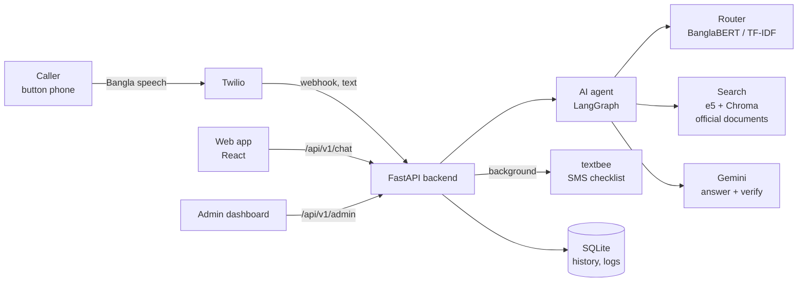

# এক কল | Ek Call

**A Bangla voice AI agent that explains government services over a simple phone call.**

A citizen calls a phone number, asks in spoken Bangla about a government service, hears a short answer
taken **only from official documents**, and gets the checklist by SMS. The same agent answers in a web app
(text or microphone), and an admin dashboard shows officers what citizens ask most.

Team **MIST_Dreamers**: Md. Tamim Hossain, Md. Ragib Hossain Rifat, Md. Ariful Islam.

---

## Why

Abdul Karim is 67, has a button phone and no internet. To learn whether he gets the old age allowance and which
papers he needs, he has to travel to an office. Ek Call answers the same question with one phone call, in his
language, from the official rules, and sends him the checklist as an SMS he can show at the office.

## What it does

| Channel | What the citizen does | What happens |
|---|---|---|
| **Phone call** | Calls the number (or presses "Call me" in the app) and asks in Bangla | A short spoken answer (at most 3 sentences), then **one SMS checklist** per service (who, papers, fee, where, source) |
| **Web app** | Types or speaks a question | Answer with a **checklist card** and **links to the official sources**; answer audio; history of past checklists (also from calls) |
| **Admin dashboard** | An officer opens `/admin` | Questions per service and channel, answered vs unanswered, latency, calls today, **topics found by K-Means**, auto-refresh every 10 s |

**The 8 services:** বয়স্ক ভাতা (old age allowance), বিধবা ভাতা (widow allowance), প্রতিবন্ধী ভাতা (disability
allowance), জন্ম নিবন্ধন (birth registration), এনআইডি সংশোধন (NID correction), ই-পাসপোর্ট (e-passport),
ই-নামজারি (land mutation), ট্রেড লাইসেন্স (trade licence).

**Safe by design:** every fact in an answer is checked against the official passages before it is spoken. If
nothing reliable is found, the agent says the fixed Bangla fallback ("…দয়া করে ৩৩৩ নম্বরে ফোন করুন…") instead of
guessing. Questions outside the 8 services get the same fallback.

## How it works



One question goes through the agent like this (details: `docs/SRS.md` 7.4):

1. **Classify**: the local router (BanglaBERT, TF-IDF as fallback) picks one of the 8 services or `other`.
   Unsure → the LLM decides. Short follow-ups ("আর কোথায় জমা দেবো?") keep the service of the last answer.
2. **Cache**: demo questions that were answered before come back in well under a second.
3. **Retrieve**: multilingual e5 embeddings search the official documents of that service (Chroma).
4. **Grade and rewrite** (app): passages that do not answer the question are dropped; the query is rewritten
   and searched again (at most 2 retries). Phone calls skip grading to stay fast.
5. **Generate**: Gemini writes a short spoken answer, a screen text and a checklist, only from the passages.
6. **Verify**: every claim and every checklist field must be supported by a passage and the answer must be
   about the question asked. Unsupported parts are removed; if nothing reliable is left → fallback.
7. **Deliver**: voice → speech (and one SMS per service per call, sent in the background); app → card + sources.

## Architecture

Clean Architecture, enforced by `backend/tests/test_architecture.py`:

```
interfaces (FastAPI routers, Twilio webhooks)   ─┐
infrastructure (Gemini, Chroma, Twilio, textbee, ─┼──> application (use cases, ports, agent steps) ──> domain (entities, rules)
                SQLAlchemy, BanglaBERT, LangGraph)─┘
```

- `domain`: entities, value objects, policies, all Bangla user texts. Standard library only.
- `application`: use cases and **ports** (`typing.Protocol`): `LLM`, `Retriever`, `ServiceClassifier`, `SmsSender`,
  `CallPlacer`, `TextToSpeech`, `BackgroundRunner`, repositories. The agent steps are plain functions here.
- `infrastructure`: one adapter per port (`GeminiLLM`, `OllamaLLM`, `ChromaRetriever`, `BanglaBertClassifier`,
  `TextbeeSms`, `ConsoleSms`, `TwilioCallPlacer`, `GttsTts`, SQLAlchemy repositories, LangGraph wiring).
- `interfaces`: HTTP and TwiML only, no business logic.
- `app/container.py` is the only place that builds adapters, chosen by `.env`. Swapping Twilio for a Bangladeshi
  IVR, Gemini for another LLM or textbee for an SMS gateway means **one new adapter and one setting**.

The web app follows the same idea: `src/domain` (types) → `src/application` (hooks, ports) →
`src/infrastructure` (API client, speech, audio) → `src/presentation` (pages, components). Components never call
`fetch`; the Bangladesh flag colours come from Tailwind tokens in `src/index.css`.

## Results

Measured on 21 to 22 Nov 2026 with `LLM_BACKEND=gemini`, model `gemini-3.5-flash-lite`, `ROUTER_BACKEND=banglabert`,
answer cache off. Full tables: [`docs/results/`](docs/results).

| Metric | Result | Target |
|---|---|---|
| Router accuracy, 108 hand-written test questions | **BanglaBERT 93.5%** (TF-IDF 89.8%); 95.4% after the LLM second opinion | ≥ 90% |
| Retrieval Recall@5 | **96.9%** | ≥ 90% |
| Answer correctness, 32 answers checked by the team against the official pages | **100%** | ≥ 90% |
| Safe refusal, 37 off-topic questions | **100%** | ≥ 95% |
| Voice latency, median (16 calls) | **5.1 s** (phone answers now cut to 3 sentences; demo questions are cached) | ≤ 5 s |

Router details: [`router_eval.md`](docs/results/router_eval.md). Retrieval, refusal, latency and the answer
check: [`rag_eval.md`](docs/results/rag_eval.md). End-to-end scenarios S1 to S9:
[`scenario_check.md`](docs/results/scenario_check.md).

## Tech stack

| Part | Tools |
|---|---|
| Backend | Python 3.11, FastAPI, SQLAlchemy + SQLite, pydantic-settings |
| AI agent | LangGraph, Gemini (`google-genai`, next key when one fails, fallback model on overload), Ollama (optional, local) |
| Router | BanglaBERT (fine-tuned, `csebuetnlp/banglabert`), TF-IDF + logistic regression (scikit-learn) |
| Search | `intfloat/multilingual-e5-small` (sentence-transformers), Chroma |
| Voice | Twilio Programmable Voice (`bn-BD` speech recognition, Bangla TTS), gTTS for the app |
| SMS | textbee (Android phone with a Bangladeshi SIM as the gateway); console mode for development |
| Topics | K-Means (scikit-learn), k by silhouette score, Bangla labels from Gemini |
| Frontend | React 19, Vite, TypeScript, Tailwind CSS 4, react-router, recharts, Web Speech API; installable (PWA) |

## Quick start

Full guide with troubleshooting: [`docs/SETUP.md`](docs/SETUP.md). Needs Python **3.11**, Node 20.19+ (22 LTS), Git.

### Backend

```powershell
git clone https://github.com/Tamim2276/Comilla-University-Hackathon.git
cd Comilla-University-Hackathon\backend
py -3.11 -m venv .venv
.venv\Scripts\Activate.ps1                     # Linux / macOS: source .venv/bin/activate
pip install torch==2.15.0 --index-url https://download.pytorch.org/whl/cpu
pip install -r requirements.txt
pip install git+https://github.com/csebuetnlp/normalizer
copy .env.example .env                         # then fill it in (see Configuration)

$env:PYTHONIOENCODING = "utf-8"                # PowerShell: print Bangla correctly
python -m scripts.ingest                       # search index from data/raw_docs (downloads e5 once)
python -m scripts.train_baseline               # TF-IDF router
python -m scripts.ask "আমার বয়স ৬৭, বয়স্ক ভাতা পাবো?"   # one answer in the terminal
uvicorn app.main:app --reload --port 8000      # API + Swagger at http://localhost:8000/docs
```

No Gemini key yet? Set `AGENT_ENGINE=stub` for a fixed sample answer while building screens.

### Web app

```powershell
cd frontend
copy .env.example .env                         # VITE_API_URL, VITE_ADMIN_TOKEN
npm install
npm run dev                                    # http://localhost:5173 (admin: /admin)
```

### Phone calls

1. `ngrok http 8000`, put the https address in `PUBLIC_URL`.
2. Twilio Console → the voice number (trial: Try out Voice → Receive a call) → webhook
   `https://<ngrok-address>/voice/incoming`, POST.
3. On a Twilio trial, only verified phone numbers can call in or receive "Call me".

## Configuration (`backend/.env`)

All variables are in [`backend/.env.example`](backend/.env.example). Write each value right after the `=`, with no
comment on the same line. Never commit `.env`.

| Variable | Meaning |
|---|---|
| `LLM_BACKEND` | `gemini` (default), `ollama` or `hybrid` |
| `GEMINI_API_KEYS` | one or more keys, comma separated; when one is out of quota or refused, the next is used |
| `GEMINI_MODEL_MAIN`, `GEMINI_MODEL_FAST`, `GEMINI_MODEL_FALLBACK` | model names; the fallback is tried once on "high demand" (503) |
| `ROUTER_BACKEND` | `banglabert` (needs `data/models/router/`, else TF-IDF is used), `tfidf` or `llm` |
| `AGENT_ENGINE` | `langgraph` (the real agent) or `stub` (fixed sample answer, no keys) |
| `PRELOAD_MODELS` | `true`: load router and search models at startup, so the first question is fast |
| `VOICE_FAST_MODE` | `true`: phone calls skip passage grading (fewer LLM calls) |
| `TWILIO_ACCOUNT_SID`, `TWILIO_AUTH_TOKEN`, `TWILIO_NUMBER`, `PUBLIC_URL` | phone calls and "Call me" |
| `VALIDATE_TWILIO_SIGNATURE`, `MISSED_CALL_MODE` | Twilio signature check; reject a call and call back (caller pays nothing) |
| `SMS_BACKEND` | `console` (prints the SMS) or `textbee` (real SMS) |
| `TEXTBEE_API_KEY`, `TEXTBEE_DEVICE_ID` | textbee gateway |
| `ADMIN_TOKEN` | protects `/api/v1/admin/*` (header `X-Admin-Token`); empty = open |
| `PHONE_HASH_SALT` | salt for the phone hash in the question logs; do not change it later |
| `FRONTEND_ORIGINS` | allowed web app addresses (CORS) |

Web app (`frontend/.env`): `VITE_API_URL` (backend address) and `VITE_ADMIN_TOKEN` (same as `ADMIN_TOKEN`; it is
built into the browser app, so it only keeps casual visitors out of the demo dashboard).

## Scripts (`backend/`, venv active)

| Command | What it does |
|---|---|
| `python -m scripts.ingest` | Builds the search index from `data/raw_docs/` (safe while the server runs); clears cached answers |
| `python -m scripts.check_docs` | Checks the official documents before ingest: every service needs at least one valid document |
| `python -m scripts.train_baseline` | Trains the TF-IDF router from `data/questions/train.csv` |
| `python -m scripts.eval_router` | Router accuracy, F1, confusion matrices → `docs/results/router_eval.md` |
| `python -m scripts.eval_rag` | Recall@5, safe refusal, latency, answer-check export → `docs/results/rag_eval.md` |
| `python -m scripts.ask "…"` (`--voice`) | Asks the agent once in the terminal |
| `python -m scripts.search "…"` | Shows the passages the search finds |
| `python -m scripts.prewarm` (`--voice`) | Answers the demo questions once, so they come from the cache |
| `python -m scripts.seed_demo_data` (`--clear`) | 60 sample questions over the past week for the dashboard (`is_demo = true`) |
| `python -m scripts.llm_smoke` | One Bangla JSON answer: checks the LLM setup |

BanglaBERT training: [`ml/README.md`](ml/README.md).

## API

Swagger: `http://localhost:8000/docs`. Contract: `docs/SRS.md` Section 8. Errors are always
`{"error": {"code", "message_bn", "message_en"}}` with a Bangla message.

| Method | Path | Purpose |
|---|---|---|
| GET | `/health` | Status of database, LLM, search index and router |
| GET | `/api/v1/services` | The 8 services (+ `other`) |
| POST | `/api/v1/chat` | Ask a question (app): answer, checklist, sources |
| GET / DELETE | `/api/v1/conversations/{phone}` | History of a phone number / delete it |
| POST | `/api/v1/callback` | "Call me": outbound call, at most once per number per 60 s |
| POST | `/api/v1/tts` | Bangla speech (MP3) for an answer |
| GET | `/api/v1/admin/stats`, `/api/v1/admin/questions` | Dashboard numbers and logged questions |
| POST / GET | `/api/v1/admin/clusters/rebuild`, `/api/v1/admin/clusters` | Question topics (K-Means) |
| POST | `/voice/incoming`, `/voice/respond`, `/voice/start`, `/voice/result`, `/voice/status` | Twilio webhooks |

## Demo (5 to 7 minutes)

1. **Problem**: Abdul Karim, 67, button phone, no internet.
2. **Phone call**: "Call me" for a verified phone (or call the number), ask on speaker
   *"আমার বয়স ৬৭। আমি কি বয়স্ক ভাতা পাবো? কী কী লাগবে?"*; show the SMS arriving.
3. **Follow-up**: *"বিধবা ভাতার জন্য কী লাগে?"*; the agent may ask about residence, answer *"হ্যাঁ"*.
4. **App**: History with the same number (shared memory); ask *"NID-te namer banan bhul, ki korbo?"* by voice;
   show the checklist card and the source links.
5. **Safety**: *"প্রতিবেশীর সাথে জমি নিয়ে ঝামেলা, কী করবো?"* → the agent refuses and points to 333.
6. **Dashboard**: numbers, questions per service, topics, unanswered list. The history there is sample data
   from `seed_demo_data` (marked "নমুনা"), plus the questions of this demo.
7. **Under the hood**: architecture, BanglaBERT vs TF-IDF, the verifier, adapters swapped by config.

Before going on stage: `/health` all ok, ngrok address = Twilio webhook = `PUBLIC_URL`, textbee phone online with
SMS balance, Twilio credit, `python -m scripts.ingest` then `python -m scripts.prewarm --voice`,
`python -m scripts.seed_demo_data`, backup video ready. Printable phrases: [`docs/results/demo_phrases.md`](docs/results/demo_phrases.md).

## Tests and checks

```powershell
cd backend;  ruff check . ; pytest -q          # unit tests with fakes (no network), integration tests, layer rules
cd frontend; npm run lint ; npm run build
```

Unit tests use in-memory fakes for every port (`backend/tests/fakes.py`); repository tests run the same checks on the
fakes and on SQLite, so the fakes cannot drift from the real database.

## Privacy

- Question logs store a **salted hash** of the phone number, never the number itself; server logs show only a
  masked number (`+880171*****78`).
- `DELETE /api/v1/conversations/{phone}` removes a number's history and checklists.
- Secrets live only in `.env` files, which are git-ignored.

## Project layout

```
backend/
  app/domain/            entities, rules, Bangla texts
  app/application/       use cases, ports, agent steps, prompts
  app/infrastructure/    adapters: llm, retrieval, ml, agent, sms, telephony, tts, db, cache, background
  app/interfaces/        FastAPI routers, Twilio voice webhooks
  app/container.py       composition root (the only place that builds adapters)
  data/raw_docs/         official documents per service, with source links
  data/questions/        seed, train, validation, test and out-of-scope questions
  scripts/               ingest, train, evaluate, prewarm, demo data
  tests/                 unit, integration, architecture
frontend/src/
  domain/ application/ infrastructure/ presentation/
ml/                      BanglaBERT training
docs/                    SRS, build plan, setup, team updates, results
```

## Limits of this build

- A Twilio **trial** number: only verified phones can call, a trial message plays first, calls last at most 10 minutes.
- Answers cover the 8 services and only what our collected official documents say; for example the allowances
  show "তথ্য পাওয়া যায়নি" for the fee, because no document we have states one.
- The LLM runs in the cloud (Gemini free tier); heavy demand can slow or refuse an answer, which the app and the
  call report with a polite Bangla message.
- The dashboard token is a demo-level protection, not a login system.

## Documentation

| File | Content |
|---|---|
| [`docs/SRS.md`](docs/SRS.md) | Requirements: what Ek Call must do (functional, non-functional, API, scenarios) |
| [`docs/BUILD_PLAN.md`](docs/BUILD_PLAN.md) | Steps, owners, progress, engineering rules |
| [`docs/SETUP.md`](docs/SETUP.md) | First-time setup per laptop |
| [`docs/TEAM_UPDATES.md`](docs/TEAM_UPDATES.md) | What changed in `main`, newest first |
| [`docs/results/`](docs/results) | Router and RAG evaluation, answer check, scenario check, demo phrases |

## Team

| Member | Built |
|---|---|
| Md. Tamim Hossain (team lead) | AI agent and its data: official documents, question sets, routers (TF-IDF, BanglaBERT, LLM), retrieval, LLM adapters, agent graph, verifier, answer cache, clustering, evaluation |
| Md. Ragib Hossain Rifat | Voice: Twilio call flow, call-back and missed-call mode, signature check, async voice answer, text-to-speech; microphone, answer audio and "Call me" in the app |
| Md. Ariful Islam | Web app (start, chat, checklist card, sources, history), SMS (textbee, console) and background runner, admin APIs and dashboard with topics, demo data, scenario checks |
