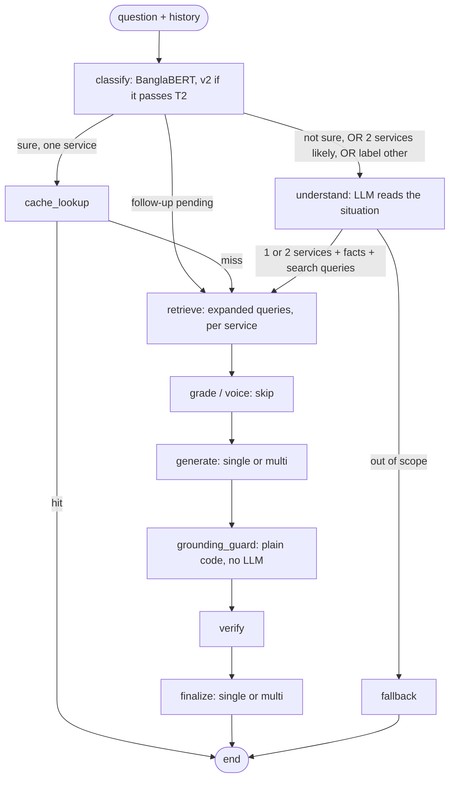

# Ek Call: 4-Hour Sprint Plan (Judges' Challenge, team 23)

Team **MIST_Dreamers**: Tamim (AI/ML, team lead), Ragib (voice), Ariful (web app, SMS, admin).
Read with `docs/SRS.md` and `docs/BUILD_PLAN.md`. Same rules as before: Clean Architecture, file ownership (BUILD_PLAN 0.4), one step at a time, `ruff check .` + `pytest -q` + `npm run build` green before every merge. Save this file as `docs/SPRINT_PLAN.md`.

---

## 0. The challenge in our words

The judges gave us two challenges:

1. **Situation, not service name.** A caller describes their life ("my husband died last year and I can't run the family") instead of saying "বিধবা ভাতা". The router and RAG must still find the right service and the right rule.
2. **Two services with contradicting rules.** A caller mixes two services ("I am a widow and 66, can I get old age allowance and widow allowance together?"). The answer must stay grounded: each rule comes from its own service's official document, rules are never blended, and when the documents disagree or say nothing, we say so instead of picking a winner.

Direction from the judges: **describe the situation, not the service name.**

### 0.1 What each challenge means in plain words

**Challenge 1.** Today a caller has to say "বিধবা ভাতা" to get a good answer. Real callers don't know the official name; they say "স্বামী মারা গেছেন, সংসার চলে না". The agent must work out the service from the story. Appendix C has 16 example situations (2 per service) plus 2 edge cases that show what this looks like.

**Challenge 2.** The caller asks about two services in one sentence, and the two official documents say different things about the same point. Example: "আমি বিধবা, বয়স ৬৬। বয়স্ক ভাতা আর বিধবা ভাতা দুটোই কি একসাথে পাবো?" The old age document might say "apply at office X, bring papers A and B", while the widow document says "apply at office Y, bring papers A and C". There are three ways to get this wrong:

| Failure | What it looks like | What stops it |
|---|---|---|
| **Blending** | "Bring A, B and C to office X." One rule taken from each document, making a rule that exists nowhere | `grounding_guard` drops any claim that cites another service's passage (T5, `test_grounding_guard.py`) |
| **Picking a winner** | "The widow rule applies to you." No document says which one wins | Conflicts are shown side by side, each with its own source, plus `CONFLICT_NOTE` (T5, W2 ConflictBox) |
| **Inventing a combining rule** | "Yes, you can get both." Neither document says so | If no passage states the combine rule, the fixed `COMBINE_UNKNOWN` sentence is used, never a made-up yes or no (T5, S12) |

One sentence for the judges: **"We don't decide which rule is right. We show each rule with its own source, and we say so when the documents don't answer."**

**Is BERT fine-tuning needed?** Not for challenge 2: conflicts are handled after retrieval, in generate and `grounding_guard`, and BERT is not involved. For challenge 1 it is **useful but not required**: the `understand` step and query expansion do most of the work. Retraining (step **T1B**) only makes the fast router handle situations by itself, so fewer questions need the LLM (faster, saves free-tier quota). It is gated by **T2**: if v2 is not clearly better, we keep v1.

### 0.2 Definition of done (what we will show the judges)
- [ ] S10 to S16 (Section 6.3) pass in the app; S11 and S13 also pass on a real phone call.
- [ ] `docs/results/situation_eval.md` shows **before vs after** numbers on hand-written situational questions (router accuracy, Recall@5, mixed-question results).
- [ ] No regression: old `test.csv` router accuracy and `out_of_scope.csv` refusal are not worse than before (93.5% / 95.4% and 100%).
- [ ] All unit tests green, including the new grounding-guard tests, and the architecture test.
- [ ] S17 (Appendix C check set) run in the app; result per question written in `docs/results/scenario_check.md`.
- [ ] T2 model gate decision (keep v1 or switch to v2) written in `docs/results/situation_eval.md`.

### 0.3 What we will NOT do in 4 hours
- No new services, no database migrations, no new external tools.
- The agent never decides who is eligible and never says which allowance "wins" unless an official document says so.

---

## 1. Design in one page

### 1.1 What changes in the agent



Changes:

| # | Change | Why |
|---|---|---|
| 1 | **BanglaBERT v2** (step T1B, optional, gated by T2): retrain the router with situational training questions added, same settings as v1 | The current router only learned questions that name the service |
| 2 | **`understand` step** replaces `llm_classify` (same place in the graph, same 1 LLM call). It returns up to 2 services, the caller's facts (age, gender, widow, disability, goal...), a 1-line Bangla summary, and one "official words" search query per service. It also runs when the router says `other` (a situation can look like `other`) or when the second-best service is also likely | Situations need reading, not keyword matching |
| 3 | **Query expansion** in `retrieve`: search with (a) the caller's words, (b) the service's official search terms from `services.yaml`, (c) the query from `understand`. Merge, keep the best 5 per service | Documents say "বিধবা"; callers say "স্বামী মারা গেছেন" |
| 4 | **Multi-service mode** (max 2 services): retrieve per service, generate one section per service, each claim tagged with its `service_id` | Mixed questions |
| 5 | **`grounding_guard`**: plain Python, no LLM. Drops any claim whose cited passages are missing or belong to a different service; keeps a "conflict" only if both sides cite their own service's passage | Rules can never be blended across services; fully unit-testable |
| 6 | **Conflicts** shown side by side ("বয়স্ক ভাতার নিয়মে... / বিধবা ভাতার নিয়মে...") with both sources, plus the fixed `CONFLICT_NOTE`. If no document says whether two benefits can be combined, the fixed `COMBINE_UNKNOWN` text is used | Grounded handling of contradictions |
| 7 | **Follow-up** can ask one question to tell two services apart ("আপনি কি বয়স্ক ভাতা আগে থেকে পান?") | Situations are often vague |

LLM calls stay small: confident single service = unchanged; situation = same as before (understand replaces llm_classify); mixed = understand + generate + verify (+ grade in the app).

### 1.2 Contract changes (all additive, old fields stay)

**Domain (`app/domain/entities.py`)** (Tamim):
- `Service`: add `search_terms_bn: str = ""`.
- New `SituationProfile(summary_bn: str, facts: tuple[tuple[str, str], ...])`.
- New `ConflictSide(service_id: str, rule_bn: str, chunk_id: str)` and `Conflict(topic_bn: str, sides: tuple[ConflictSide, ...])`.
- `Answer`: add `service_ids: tuple[str, ...] = ()`, `checklists: tuple[Checklist, ...] = ()`, `conflicts: tuple[Conflict, ...] = ()`, `situation: SituationProfile | None = None`, `mode: str = "single"`. `service_id` and `checklist` stay = the first (primary) service.
- `RouterSource`: add `situation` (decided by `understand`).
- New helper `ServiceSet` (pure): `format(ids) -> "a,b"`, `parse("a,b") -> ("a","b")`, used to keep 2 services in the existing `messages.service_id` text column (no DB migration).

**Policies + config** (Tamim; `config.py` LLM / router block):

| Variable | Default | Meaning |
|---|---|---|
| `SITUATION_MODE` | `true` | turn the whole feature on/off (demo safety switch) |
| `MULTI_SERVICE_MIN_PROB` | `0.25` | if the router's 2nd label has at least this probability, run `understand` |
| `MAX_SERVICES_PER_QUESTION` | `2` | |
| `QUERY_EXPANSION` | `true` | |
| `MAX_SPEECH_WORDS_MULTI` | `60` | spoken answer limit in multi mode |
| `ROUTER_MODEL_DIR` | `data/models/router` | switch to `router_v2` only after the gate in Step T2 |

**Bangla strings (`messages_bn.py`)** (Tamim):

| Key | Text |
|---|---|
| `MULTI_INTRO` | আপনার কথায় দুটি সেবার কথা আসছে: {a} আর {b}। |
| `CONFLICT_NOTE` | এই দুই সেবার নিয়ম আলাদা। আপনার ক্ষেত্রে কোনটি প্রযোজ্য, তা উপজেলা অফিস ঠিক করবে। |
| `COMBINE_UNKNOWN` | দুটি সুবিধা একসাথে পাওয়া যায় কিনা, সরকারি কাগজে আমি নিশ্চিত তথ্য পাইনি। |
| `TWO_SMS` | দুটি সেবার জন্য আলাদা দুটি এসএমএস পাঠানো হয়েছে। |
| `SITUATION_HEARD` | আমি যা বুঝেছি: {summary} |

**API (`ChatResponse`, additive)** (Tamim edits the frozen `schemas.py` once in Step T0, with the team's OK):
```json
{
  "...all old fields...": "unchanged (service, checklist = primary service)",
  "mode": "single | multi",
  "situation": {"summary_bn": "স্বামী মারা গেছেন, দুই সন্তান, আয় নেই", "facts": {"marital_status": "বিধবা"}} ,
  "services": [{"id": "old_age_allowance", "name_bn": "বয়স্ক ভাতা", "name_en": "Old Age Allowance"}],
  "checklists": [{"service_id": "old_age_allowance", "who": "...", "papers": ["..."], "fee": "...", "where": "...", "decision": "..."}],
  "conflicts": [{"topic_bn": "বয়সের শর্ত", "sides": [
      {"service_id": "old_age_allowance", "rule_bn": "...", "source_title": "...", "source_url": "..."},
      {"service_id": "widow_allowance", "rule_bn": "...", "source_title": "...", "source_url": "..."}]}]
}
```
`situation` is `null` and `conflicts` is `[]` when not used. Old clients keep working.

**Requirements to add to `docs/SRS.md`** (Tamim, after the sprint):

| ID | Requirement | Priority |
|---|---|---|
| FR-AGT-19 | Situation understanding: when the router is unsure, says `other`, or sees a likely 2nd service, the `understand` step extracts up to 2 services, the caller's facts, a summary and one search query per service. | MUST |
| FR-AGT-20 | Query expansion: retrieval searches with the caller's words, the service's `search_terms_bn` and the `understand` query, merged per service. | MUST |
| FR-AGT-21 | Multi-service questions (max 2): retrieval, checklists and SMS per service. | MUST |
| FR-AGT-22 | Service-attributed grounding: every claim names its service and cites a passage of that same service (checked in code by `grounding_guard`); contradicting rules are shown side by side with both sources; no rule is declared the winner unless a document says so; `CONFLICT_NOTE` / `COMBINE_UNKNOWN` are fixed texts. | MUST |
| FR-AGT-23 | One follow-up question may be used to tell two candidate services apart. | SHOULD |
| FR-APP-11 | App shows the situation summary, one checklist card per service and a "rules differ" box with both sources. | MUST |
| FR-DATA-10 | `situation_seed.csv` (training), `situation_test.csv` and `mixed_test.csv` (hand-written, never augmented). | MUST |
| FR-DATA-11 | `scripts/eval_situation.py` writes before/after results to `docs/results/situation_eval.md`. | MUST |

---

## 2. Timeline (4 hours)

Times are minutes from the start (T+0 = when you begin).

| Time | Tamim | Ragib | Ariful |
|---|---|---|---|
| T+0 to 15 | **K0** kick-off together: read this plan, create branches | K0 | K0 |
| T+15 to 45 | **T0** contract (entities, config, strings, schemas, fakes) | **D1** write `situation_test.csv` (half) + `mixed_test.csv` (half) by hand | **D1** the other half by hand |
| T+45 | **Sync A**: merge T0 + datasets; everyone pulls `main` | | |
| T+45 to 65 | **T1** situation seeds + augment + leak check | **V1** voice: multi speech + TwiML tests | **W1** AskQuestion: many checklists + one SMS per service |
| T+65 to 75 | **T1B** start BanglaBERT v2 retrain (then runs about 13 min in background) + TF-IDF v2 | V1 | W1 |
| T+75 to 135 | **T3** `understand` step + routing; **T2** model gate (5 min, at about T+110); **T4** query expansion | **E1** `scripts/eval_situation.py` (with fake-engine test) | **W2** app: situation chip, many cards, conflict box |
| T+135 to 165 | **T5** multi generate + `grounding_guard` + verify + finalize | **V2** real-call checks of S11, S13 | **W3** history shows multi answers; 360 px check |
| T+165 | **Sync B** (feature freeze): merge all; run S10 to S16 in the app; run `eval_situation` | | |
| T+165 to 210 | **T6** tune `MULTI_SERVICE_MIN_PROB` on the **val** set only; fix prompts | **V3** phone scenario run + latency log | **W4** scenario checks in app, fix UI bugs |
| T+210 to 240 | **F1** all: final tests, results file, SRS addendum, rehearse the new demo (Section 8) | | |

Merge small pull requests often. If a step is late, use the cut-lines in Section 7.

---

## 3. Steps: Tamim (agent + data)

### K0: Kick-off (all, T+0 to 15)
1. Everyone reads Sections 0, 1 and 6.
2. Branches: `tamim/s-t0-contract`, `ragib/s-d1-test-data`, `ariful/s-d1-test-data`, then one branch per step.
3. Decide the 4 demo questions now (Section 8) so everyone tests the same ones.

### T0: Contract (T+15 to 45) **blocks code of others, so do it first**
Files: `app/domain/entities.py`, `value_objects.py` (`RouterSource.situation`), `policies.py`, `messages_bn.py`, new `app/domain/service_set.py`, `app/config.py` + `.env.example` (LLM/router block), `app/interfaces/api/schemas.py` (additive fields, team OK), `app/application/dto.py`, `tests/fakes.py` (FakeLLM can return the new JSON shapes), `data/services.yaml` (`search_terms_bn` per service).

`search_terms_bn` examples (write one line per service from the official documents' own words):
- `widow_allowance`: `বিধবা স্বামী মৃত স্বামী নিগৃহীতা মহিলা ভাতা যোগ্যতা আবেদন`
- `old_age_allowance`: `বয়স্ক ভাতা বয়স পুরুষ নারী যোগ্যতা আবেদন`
- `disability_allowance`: `প্রতিবন্ধী ভাতা প্রতিবন্ধিতা সনদ সুবর্ণ নাগরিক কার্ড`
- `land_mutation`: `নামজারি খারিজ জমি ক্রয় ওয়ারিশ খতিয়ান`
(fill the other services the same way, using words that really appear in our documents)

Tests (new file `tests/unit/test_sprint_contract.py`): `ServiceSet` format/parse round trip; `Answer` defaults keep old behaviour (`mode="single"`, empty tuples); `ChatResponse` still validates an old-style answer.

**Done-check:** `pytest -q` and the architecture test green; Swagger `/api/v1/chat` still answers S1 exactly as before.

### T1: Situation training data (T+45 to 65)
Files: `data/questions/situation_seed.csv`, `scripts/augment_questions.py` (add `--input` and `--check-leak` options).
1. Write `situation_seed.csv` (`text,label`): about 10 situational questions per label that **do not name the service** (use Appendix A as the style; Claude Code may draft them from our documents, Tamim reviews every line). Include 10 situational `other` questions (crop disease, land boundary dispute, medical problem).
2. Split seeds 90/10 by seed, then augment (casual, misspelt, Banglish, speech-recognition errors) as before; append to `train.csv` / `val.csv` into new files `train_v2.csv` / `val_v2.csv` (keep the old ones).
3. **Leak check** (`--check-leak`): no line of `situation_test.csv`, `mixed_test.csv` or `situation_check.csv` (Appendix C) may appear in `train_v2.csv` / `val_v2.csv` (exact match after trimming spaces and `।?`). The script exits with an error and prints the lines if any match.

**Done-check:** `train_v2.csv` / `val_v2.csv` written; leak check prints `0 overlaps`; label counts printed (every label has situational rows).

### T1B: BanglaBERT v2 retrain (T+65 to 75 to start; training runs in background) **optional, gated by T2**
Why: the current router (93.5% on `test.csv`) learned questions that name the service. Situation sentences look different, so its confidence often falls below 0.7 and every such question goes to the LLM. Retraining teaches the fast router situations. It is **not required** for correctness: `understand` covers the gap if this step fails.

Files: `ml/train_router.py` (add `--train`, `--val`, `--out` options if missing; do not change anything else), `ml/train_tfidf.py` (same options), new `tests/unit/test_router_v2_labels.py`.
1. Use **the same settings as v1** (base model `csebuetnlp/banglabert`, epochs, learning rate, max length, batch size, seed). Only the data changes, so the before/after comparison is fair.
2. Start training in the background, writing to a new folder (never overwrite v1):
   ```bash
   nohup python -m ml.train_router --train data/questions/train_v2.csv --val data/questions/val_v2.csv \
     --out data/models/router_v2 > logs/train_router_v2.log 2>&1 &
   ```
   About 13 minutes on CPU (same as v1). If a free Colab GPU is ready, it takes about 2 minutes there; copy the folder back.
3. Retrain TF-IDF too (seconds): `python -m ml.train_tfidf --train data/questions/train_v2.csv --out data/models/tfidf_router_v2.joblib`.
4. Do not wait. Go to T3. Check the log once at about T+90 (`tail logs/train_router_v2.log`).
5. Test `test_router_v2_labels.py` (skips if the folder is missing): the v2 label list equals the v1 label list in the same order, so `services.yaml` ids still match.
6. Do **not** change `ROUTER_MODEL_DIR` here. Only T2 decides that.

**Done-check:** `data/models/router_v2/` has the model, tokenizer and label map; the log shows the val macro-F1; `tfidf_router_v2.joblib` saved; label test green.

**Time cap:** if training crashes or is not finished by T+110, stop it, keep v1 and note "v2 skipped" in `situation_eval.md`. Do not spend sprint time debugging training.

### T2: Model gate (about T+110, 5 minutes)
Run `python -m scripts.eval_router --model-dir data/models/router_v2` on `test.csv` and `situation_test.csv` (and the same for v1, if those numbers are not saved yet).
Switch `ROUTER_MODEL_DIR=data/models/router_v2` **only if** v2 is not worse on `test.csv` (allow at most 1 point drop) **and** is better on `situation_test.csv`. Otherwise keep v1 and rely on `understand`. Write both numbers and the decision in `docs/results/situation_eval.md`. Rerun `pytest -q` after switching.

### T3: `understand` step + routing (T+75 to 110)
Files: `app/application/agent/state.py`, `steps.py`, `routing.py`, `prompts.py`, `app/infrastructure/agent/langgraph_engine.py`, `app/infrastructure/ml/llm_classifier.py` (reuse prompt if needed).
1. State: add `service_ids: list[str]`, `situation: dict | None`, `search_queries: dict[str, str]`, `mode: str`, `conflicts: list`.
2. `route_after_classify(state, settings)`:
   - pending follow-up: keep service(s) (parse with `ServiceSet`) and go to `retrieve`;
   - `SITUATION_MODE` and (`top1 < threshold` or `top1 == "other"` or `p2 >= MULTI_SERVICE_MIN_PROB`): go to `understand`;
   - else (single, confident): `cache_lookup` as before.
3. `understand` (FAST model, one call). Prompt input: question, last 3 turns, router top 3 with probabilities, the 9 labels with Bangla names and one-line descriptions from `services.yaml`. JSON output:
   ```json
   {"services": ["widow_allowance"], "out_of_scope": false,
    "facts": {"age": "৬৬", "gender": "নারী", "marital_status": "বিধবা"},
    "summary_bn": "স্বামী মারা গেছেন, বয়স ৬৬",
    "search_queries": {"widow_allowance": "বিধবা ভাতা যোগ্যতা ও প্রয়োজনীয় কাগজ"},
    "needs_follow_up": false, "follow_up_question": null}
   ```
   Rules in the prompt: max 2 services; only services from the list; `out_of_scope=true` if none fits; never guess facts that were not said.
4. `route_after_understand`: `out_of_scope` or no service: `fallback`; `needs_follow_up`: `finalize_follow_up`; else `retrieve` with `mode = "multi"` if 2 services.
5. Router source = `situation`. Do not use the cache for situation or multi answers (cache only single + confident, as now).

Unit tests (`tests/unit/test_situation_routing.py`, FakeClassifier + FakeLLM):
- confident single label: `understand` is NOT called;
- low confidence: `understand` called once, `service_ids` from its JSON;
- router says `other` + understand returns a service: answered, not fallback;
- router says `other` + understand says out of scope: FALLBACK text exactly;
- `p2 >= 0.25`: understand called; 2 services gives `mode="multi"`;
- understand returns an unknown label: ignored (never trust the LLM label list blindly).

### T4: Query expansion (T+110 to 135)
Files: new `app/application/agent/queries.py` (pure), `steps.py` (`retrieve`).
1. `build_queries(question, service, llm_query) -> list[str]`: `[question, f"{service.name_bn} {service.search_terms_bn}", llm_query]`, dropping empty/duplicate ones; if `QUERY_EXPANSION=false`, only `[question]`.
2. `retrieve` for each service in `service_ids`: run the Retriever for each query with the service filter, merge by `chunk_id` keeping the best score, take top 5 per service (multi: top 3 per service). Keep the "also search all services" rule only for single mode.
3. Passages keep their `service_id` (already in the metadata).

Unit tests (`tests/unit/test_query_expansion.py`): queries built and de-duplicated; expansion off gives one query; multi mode calls the retriever with each service filter; merge keeps the best score per chunk.

### T5: Multi generate + grounding guard + verify + finalize (T+135 to 165)
Files: `prompts.py`, `steps.py`, new `app/application/agent/grounding.py` (pure), `routing.py`.
1. `generate` in multi mode uses a multi prompt. Passages are shown grouped: `[old_age_allowance][P1] title: text`. JSON output:
   ```json
   {"no_answer": false,
    "sections": [{"service_id": "old_age_allowance", "speech_text": "...", "checklist": {...},
                  "claims": [{"text": "...", "service_id": "old_age_allowance", "passage_ids": ["P1"], "core": true}]}],
    "conflicts": [{"topic_bn": "...", "sides": [{"service_id": "old_age_allowance", "rule_bn": "...", "passage_ids": ["P1"]},
                                               {"service_id": "widow_allowance", "rule_bn": "...", "passage_ids": ["P4"]}]}],
    "combine_rule": {"stated": false, "text_bn": null, "passage_ids": []},
    "follow_up_question": null}
   ```
   Prompt rules (add to SRS Appendix B): write each service's rules only from that service's passages; never mix rules of two services in one sentence; if the rules differ, list both in `conflicts`; do not say which rule wins or whether both can be received unless a passage says it (`combine_rule.stated=true` with that passage); use the caller's facts only to point to the relevant rule, never to decide eligibility.
2. `grounding_guard(draft, passages) -> draft` (no LLM, runs before `verify`):
   - drop a claim if any `passage_id` is unknown;
   - drop a claim if its `service_id` differs from the `service_id` of any passage it cites;
   - drop a conflict unless it has at least 2 sides, from different services, each citing a passage of its own service;
   - drop `combine_rule` (set `stated=false`) unless its passages exist;
   - report `dropped_core` so routing can retry (same shared retry counter) or fall back.
3. `verify` (LLM) checks the remaining claims and conflict sides as before.
4. `finalize` multi: speech = `MULTI_INTRO` + one short line per service (each trimmed to about 18 words) + `CONFLICT_NOTE` if conflicts + `COMBINE_UNKNOWN` if the caller asked about getting both and `combine_rule.stated` is false; cap at `MAX_SPEECH_WORDS_MULTI`; add `DECISION_NOTE`. Fill `service_ids`, `checklists`, `conflicts`, `situation`; primary = first service. Citations = only passages actually used.
5. Single mode keeps today's path; the guard also runs there (claims must cite the chosen service).

Unit tests (`tests/unit/test_grounding_guard.py`, all plain code, no network). **These are the most important tests of the sprint:**
- claim tagged `old_age_allowance` citing a `widow_allowance` passage: dropped;
- claim citing an unknown passage `P9`: dropped;
- conflict with only one side: dropped; conflict where both sides are the same service: dropped; valid conflict: kept;
- `combine_rule.stated=true` without passages: becomes `stated=false`;
- dropping a core claim sets `dropped_core=True`;
- finalize multi: speech <= 60 words, contains both service names, contains `CONFLICT_NOTE` when conflicts exist, never contains a combine statement when `stated=false`.

Plus `tests/unit/test_multi_agent_flow.py`: a full graph run with FakeLLM returning a mixed answer ends with `mode="multi"`, 2 checklists, 1 conflict, and the citations only from retrieved passages.

### T6: Tune and fix (T+165 to 210)
1. Tune `MULTI_SERVICE_MIN_PROB` (try 0.15, 0.25, 0.35) on `val_v2.csv` plus the mixed **seed** examples, never on `situation_test.csv` / `mixed_test.csv`.
2. Read 10 real answers (app) and fix prompt wording; re-run unit tests.
3. Check `out_of_scope.csv` refusal is still 100% (the new `understand` path must not "rescue" off-topic questions).

---

## 4. Steps: Ragib (voice + evaluation)

### D1: Hand-written test data (T+15 to 45, with Ariful)
Write these **yourselves, without an LLM**, and do not look at `situation_seed.csv` (keeps the test honest).
- `data/questions/situation_test.csv` (`text,label`): 4 situational questions per label for 4 labels each (Ragib: old age, widow, disability, birth registration + 2 `other`; Ariful: NID correction, e-passport, land mutation, trade licence + 2 `other`). Rule: **the service name must not appear** (no "ভাতা" + service word, no "পাসপোর্ট", etc.; describe the life situation).
- `data/questions/mixed_test.csv` (`text,labels,expects_conflict`): 5 each. `labels` uses `;` (for example `old_age_allowance;widow_allowance`). `expects_conflict` = `yes` if the two services have different rules on the same point (age, papers, office), else `no`.
- Ragib also copies Appendix C as-is into `data/questions/situation_check.csv` (`text,label`, 18 rows). This is a third, separate set: it is used for S17 and reported on its own line in E1, never mixed into `situation_test.csv` and never used for training or tuning.
Commit to your branch; Tamim merges at Sync A.

### V1: Multi answers on the phone (T+45 to 75)
Files: `app/interfaces/voice/router.py`, `twiml.py`, `tests/unit/test_twiml_multi.py`.
1. In multi mode speak `answer.speech_text` (already built by finalize) and add `TWO_SMS` instead of `SMS_SENT` when 2 SMS were scheduled.
2. A follow-up from `understand` is spoken and listened to like any follow-up (no goodbye on "হ্যাঁ"/"না").
3. Optional, if Twilio supports it on your `<Gather>`: add `hints` with the 8 service names and common situation words (for example "বিধবা, প্রতিবন্ধী, নামজারি, ট্রেড লাইসেন্স"). Test that it does not cause an error.
Tests: multi TwiML contains the speech + `TWO_SMS` + CONTINUE inside one `<Gather>`; speech length <= 60 words; follow-up path keeps the call alive.

### E1: Evaluation script (T+75 to 135; Tamim owns `scripts/`, Ragib writes this one file with his OK)
File: `scripts/eval_situation.py`, test `tests/unit/test_eval_situation.py` (runs the metric functions on tiny fake data).
Outputs `docs/results/situation_eval.md` with:
1. **Router on `situation_test.csv`:** accuracy and macro-F1 for TF-IDF v1, TF-IDF v2, BanglaBERT v1, BanglaBERT v2 (if T1B finished), and "router + understand" (the full classify path). Repeat on `situation_check.csv` as a separate table, labelled "Appendix C check set".
2. **Recall@5 on `situation_test.csv`:** caller's words only vs expanded queries (`QUERY_EXPANSION` false/true).
3. **Mixed (`mixed_test.csv`):** both services detected (%), at least one correct (%), guard pass rate (answers where no claim was dropped for wrong service), conflict reported when `expects_conflict=yes` (%), fake conflict reported when `no` (%).
4. **Regression:** router accuracy on `test.csv`, refusal on `out_of_scope.csv`.
5. Average LLM calls and latency per question, and which `LLM_BACKEND` / model was used.
Run with the cache off. To save quota: router and recall parts use no LLM; only the "router + understand" and mixed parts call the LLM (about 50 calls in total).

### V2 / V3: Real-call checks (T+135 to 210)
1. Call the number and run S11 and S13 (Section 6.3) three times each. Note the transcript Twilio heard, the service chosen, the latency and whether the SMS arrived (`docs/results/issues.md`).
2. If a multi answer takes longer than the voice budget, confirm the "please wait" async path still delivers it (FR-CALL-10).
3. Ask each demo question once in a real call before judging (warms nothing for multi, but checks Twilio's Bangla transcript).

---

## 5. Steps: Ariful (AskQuestion, SMS, app)

### D1: Hand-written test data (T+15 to 45)
See Ragib's D1: your half of `situation_test.csv` and `mixed_test.csv`.

### W1: AskQuestion with several checklists (T+45 to 75)
Files: `app/application/use_cases/ask_question.py`, `tests/unit/test_ask_question_multi.py`.
1. Save one `checklists` row per checklist in `answer.checklists` (fall back to `answer.checklist` when empty).
2. Save the assistant message with `service_id = ServiceSet.format(answer.service_ids)` when there are 2 (so a pending follow-up keeps both).
3. SMS: for voice, for **each** service in the answer, send one SMS if none was sent yet for `(call_sid, service_id)` (the existing rule, now in a loop). Mark first, then submit to the BackgroundRunner.
4. `question_logs.service_id` = primary service (keeps the admin charts working).
Tests: multi voice answer sends exactly 2 SMS; asking the same mixed question again in the same call sends 0 more; app channel sends none; fallback sends none; both checklists saved.

### W2: App shows situations and conflicts (T+75 to 135)
Files: `src/domain/types.ts`, `presentation/components/` new `SituationChip.tsx`, `ConflictBox.tsx`, updated `MessageBubble` / `ChecklistCard` usage.
1. Types for the new optional fields (`mode`, `situation`, `services`, `checklists`, `conflicts`).
2. **Situation chip** above the answer: `SITUATION_HEARD` text, for example "আমি যা বুঝেছি: স্বামী মারা গেছেন, বয়স ৬৬".
3. **One checklist card per service** (stacked on mobile), each with its own service tag and sources.
4. **ConflictBox** ("নিয়ম আলাদা"): for each conflict, a two-column (stacked on 360 px) list: service name, the rule, source link. Neutral style (no "winner" colour), the `CONFLICT_NOTE` text under it.
5. Example chips: replace 2 old chips with 2 situation examples from Section 8.
**Done-check:** `npm run build` green; S10 and S12 look right at 360 px and on desktop.

### W3 / W4: History + scenario checks (T+135 to 210)
1. History shows both checklists of a multi answer.
2. Run S10, S12, S14, S15, S16 and S17 in the app; fill `docs/results/scenario_check.md` (pass/fail + note; for S17 one row per question with the service the app chose). Report wrong answers to Tamim with the exact question text.

---

## 6. Test plan

### 6.1 Gates (every merge)
- `ruff check .` and `pytest -q` (all old tests + new ones) in `backend/`; `npm run build` in `frontend/`.
- `tests/test_architecture.py` green: `grounding.py`, `queries.py`, `service_set.py` must import only domain/stdlib.

### 6.2 New unit tests (no network)
| File | Owner | What it proves |
|---|---|---|
| `test_sprint_contract.py` | Tamim | New fields are additive; old answers unchanged |
| `test_router_v2_labels.py` | Tamim | Retrained router keeps the same labels in the same order (skips if v2 is missing) |
| `test_situation_routing.py` | Tamim | When `understand` runs, out-of-scope still refused, unknown labels ignored |
| `test_query_expansion.py` | Tamim | Queries built and merged per service |
| `test_grounding_guard.py` | Tamim | No claim can cite another service's document; conflicts need both sides |
| `test_multi_agent_flow.py` | Tamim | Full multi run with fakes |
| `test_twiml_multi.py` | Ragib | Multi speech, two-SMS line, follow-up on the phone |
| `test_eval_situation.py` | Ragib | Metric functions are correct on tiny data |
| `test_ask_question_multi.py` | Ariful | One SMS per service per call, both checklists saved |

### 6.3 Scenarios (app and phone)
| # | Where | Ask | Expected |
|---|---|---|---|
| S10 | App | "আমার স্বামী গত বছর মারা গেছেন, দুটো বাচ্চা নিয়ে খুব কষ্টে আছি। সরকার থেকে কোনো সাহায্য পাওয়া যায়?" | `widow_allowance`, situation chip, checklist + source, router source `banglabert` or `situation` |
| S11 | Phone | "বাবা মারা যাওয়ার পর জমিটা এখনো বাবার নামেই আছে, আমাদের নামে করবো কীভাবে?" | `land_mutation`; short spoken answer; 1 SMS |
| S12 | App | "আমি বিধবা, বয়স ৬৬। বয়স্ক ভাতা আর বিধবা ভাতা দুটোই কি একসাথে পাবো?" | `mode=multi`, 2 cards, each rule cites its own service; if our documents do not state the combine rule: `COMBINE_UNKNOWN` (never "yes" or "no" invented); `CONFLICT_NOTE` if rules differ |
| S13 | Phone | "আমার বাবার বয়স সত্তর, আবার চোখেও দেখেন না। কোন ভাতার জন্য আবেদন করবো?" | old age + disability; speech names both, <= 60 words; 2 SMS |
| S14 | App | "ধান ক্ষেতে পোকা লেগেছে, কী ওষুধ দেবো?" | exact FALLBACK |
| S15 | App + phone | S1, S4, S7 from the SRS | same results as before (regression) |
| S16 | App | "সরকারি কোনো ভাতা কি পাবো?" (no facts) | one follow-up question, then a correct answer after the reply |
| S17 | App (5 of them also by phone in V3) | All 18 rows of Appendix C | C1 to C16: the right service, answer cites that service's document; C17: exact FALLBACK; C18: one follow-up question, no guess. Target: at least 14 of C1 to C16 right, C17 and C18 must pass |

### 6.4 Evaluation (Section 4, E1)
Run once at Sync B and once at F1. Put the final table in `docs/results/situation_eval.md` and copy the 3 main numbers into Section 8.

---

## 7. Cut-lines (if late)

| If by... | ...this is not working | Then |
|---|---|---|
| T+110 | T1B retrain crashed, not finished, or T2 gate failed | Keep v1; the `understand` step carries situations; report v1 numbers and "v2 skipped / not better" |
| T+135 | Query expansion | Keep only `search_terms_bn` expansion (no LLM query) |
| T+165 | Multi generate | Answer the primary service fully and add one line: "আরেকটি সেবা ({b}) নিয়েও প্রশ্ন আছে, আলাদা করে জিজ্ঞেস করুন।" Keep the guard (it is the grounding story) |
| T+165 | ConflictBox UI | Show both checklist cards + `CONFLICT_NOTE` text only |
| T+210 | Anything unstable | `SITUATION_MODE=false` restores the old behaviour for the demo; show the new feature in the app only |

---

## 8. What we tell the judges (fill the numbers at F1)

**Demo (3 minutes):** S10 in the app (situation chip) then S13 on the phone (two services, 2 SMS) then S12 in the app (rules side by side, `COMBINE_UNKNOWN` if no document says it) then S14 (refusal).

**Talking points:**
1. "Callers describe their life, not a service name. We retrained BanglaBERT with situational questions and added an `understand` step that reads the situation, pulls out the facts and writes the search in the documents' own words."
2. "On hand-written situational questions the router went from 72.2% to 100% (router + understand), and Recall@5 from 62.5% to 87.5% with query expansion." (from `situation_eval.md`)
3. "For mixed questions every fact carries its service, and a plain-code guard throws away any fact that cites another service's document. So rules can never be blended. If two rules differ, we show both with their sources; we never pick a winner unless an official document says so."
4. "Out-of-scope refusal is 100% (84% on the old path), and the old test set did not get worse (93.5%, same router)."

**Likely follow-up questions:**

| Judge asks | Answer (who) |
|---|---|
| "Did you have to retrain BERT?" | "We retrained it with situational questions, same settings, only new data. It was much better on hand-written situations (94.4% vs 72.2%) but worse on the old test (87.0% vs 93.5%), so the gate kept v1. Even without it, the `understand` step handles situations; the retrain just keeps more questions on the fast path." (Tamim; if v2 failed the gate: "We tried it, it was not better, so we kept v1. That is why we have a gate.") |
| "Who wrote the test questions?" | "Ragib and Ariful by hand, without an LLM, and a script checks none of them are in the training data." (Ragib) |
| "What if both documents are silent on combining two allowances?" | "Then the agent says it couldn't find confirmed information and tells the caller where to ask. It never says yes or no on its own." (Tamim) |
| "Why plain code for the guard, not an LLM?" | "An LLM could make the same mistake it is checking. Plain code is predictable, and we can unit-test it." (Tamim) |

---

## Appendix A: Style examples for `situation_seed.csv` (training only, NOT for the test set)

| label | example |
|---|---|
| old_age_allowance | বাবার বয়স সত্তর পার হয়েছে, কোনো আয় নেই, সরকার থেকে মাসে মাসে কিছু পাওয়া যায়? |
| old_age_allowance | মায়ের বয়স হয়েছে, কাজ করতে পারেন না, কোথায় গেলে সাহায্য পাবো? |
| widow_allowance | স্বামী মারা যাওয়ার পর সংসার চালাতে পারছি না, কোনো সরকারি সাহায্য আছে? |
| widow_allowance | স্বামী ছেড়ে চলে গেছে, এখন একা থাকি, কোনো ভাতা পাওয়া যায়? |
| disability_allowance | ছেলে জন্ম থেকে হাঁটতে পারে না, ওর জন্য সরকারি কিছু আছে? |
| disability_allowance | দুর্ঘটনায় এক পা হারিয়েছি, এখন কাজ করতে পারি না। |
| birth_registration | বাচ্চার বয়স দুই মাস, পরে স্কুলে ভর্তির সময় যে কাগজ লাগে সেটা কীভাবে করবো? |
| nid_correction | আইডি কার্ডে বাবার নামের বানান ভুল, ব্যাংকে টাকা তুলতে পারছি না। |
| e_passport | সৌদি আরবে কাজে যাবো, আগে কোন কাগজটা করতে হবে? |
| land_mutation | নতুন জমি কিনেছি, খাজনা দিতে গেলে বলে আগে নিজের নামে করতে হবে। |
| trade_licence | বাজারে একটা মুদি দোকান খুলতে চাই, সরকারি কী অনুমতি লাগবে? |
| other | প্রতিবেশী আমার জমির সীমানা দখল করেছে, কী করবো? |

Mixed examples for tuning and the demo (not for `mixed_test.csv`):
- বিধবা + বয়স্ক: "আমার মা বিধবা, বয়স ৬৫, কোন ভাতাটা নেবেন?"
- জন্ম নিবন্ধন + পাসপোর্ট: "বাচ্চার জন্ম নিবন্ধন নেই, ওর পাসপোর্ট করতে চাই।"
- এনআইডি + পাসপোর্ট: "আইডি কার্ডে নামের বানান একরকম, জন্ম নিবন্ধনে আরেকরকম। পাসপোর্ট করবো, কোনটা ধরবে?"
- নামজারি + ট্রেড লাইসেন্স: "বাবার নামের জমিতে দোকান দেবো, কী কী করতে হবে?"

## Appendix B: Prompt for Claude Code (copy for each step)
> Read `docs/SPRINT_PLAN.md`, `docs/SRS.md` and `CLAUDE.md`. Do step **<ID>** only. Change only the files listed in that step (they are mine per BUILD_PLAN 0.4). Write the unit tests listed in the step first, then the code, then run `ruff check .` and `pytest -q` (and `npm run build` for frontend work) and show me the result. Keep Clean Architecture: new pure logic (`grounding.py`, `queries.py`, `service_set.py`) imports only domain and the standard library.

## Appendix C: Challenge 1 check set (`situation_check.csv`, NOT for training, NOT for tuning)

Each question describes a life situation and never says the service name. Used for S17 and as a separate line in E1. The T1 leak check makes sure none of these end up in training data.

| # | label | Caller says |
|---|---|---|
| C1 | old_age_allowance | আমার দাদির বয়স আশি, ছেলেরা কেউ দেখে না। সরকার থেকে কি মাসে কিছু পাওয়া যায়? |
| C2 | old_age_allowance | বয়স হয়ে গেছে, আর রিকশা চালাতে পারি না। সংসার চলবে কীভাবে? |
| C3 | widow_allowance | স্বামী মারা যাওয়ার পর শ্বশুরবাড়ি থেকে বের করে দিয়েছে, এখন বাবার বাড়িতে আছি। সরকারি সাহায্য আছে? |
| C4 | widow_allowance | তিন বছর ধরে স্বামী নেই, একা সংসার চালাচ্ছি। কোথায় গেলে সাহায্য পাবো? |
| C5 | disability_allowance | আমার মেয়ে জন্ম থেকে কানে শোনে না, ওর জন্য সরকার কি কিছু দেয়? |
| C6 | disability_allowance | ভাইয়ের স্ট্রোক হয়েছে, এখন বিছানায় পড়ে আছে, কাজ করতে পারে না। |
| C7 | birth_registration | ছেলের বয়স এক বছর, কিন্তু ওর নামে সরকারি কোনো কাগজ নেই। স্কুলে ভর্তির সময় লাগবে বলেছে। |
| C8 | birth_registration | মেয়ে গ্রামে জন্মেছে, হাসপাতালে যাইনি। এখন ওর জন্ম প্রমাণ করবো কীভাবে? |
| C9 | nid_correction | ভোটার আইডিতে আমার জন্মতারিখ ভুল ছাপা হয়েছে, চাকরির ফর্ম পূরণ করতে পারছি না। |
| C10 | nid_correction | বিয়ের পর নাম বদলেছি, কিন্তু কার্ডে এখনো পুরনো নাম। |
| C11 | e_passport | বিদেশে চাকরি পেয়েছি, কিন্তু যাওয়ার জন্য যে বইটা লাগে সেটা আমার নেই। |
| C12 | e_passport | বিদেশে যাওয়ার কাগজটার মেয়াদ সামনের মাসে শেষ হয়ে যাবে। |
| C13 | land_mutation | দাদার জমি আমরা তিন ভাই ভোগ করছি, কিন্তু খাজনা এখনো দাদার নামেই যাচ্ছে। |
| C14 | land_mutation | জমি কিনেছি দুই বছর আগে, রেজিস্ট্রিও হয়েছে, কিন্তু রেকর্ডে আগের মালিকের নাম। |
| C15 | trade_licence | বাজারে ছোট একটা দোকান দেবো, কী কাগজ লাগবে বুঝতে পারছি না। |
| C16 | trade_licence | ব্যাংকে ঋণ চাইতে গেলে ব্যবসার বৈধ কাগজ চেয়েছে। |
| C17 | other | গরুর পা ফুলে গেছে, কী করবো? (expected: exact FALLBACK) |
| C18 | vague | আমি খুব গরিব, সরকার থেকে কি কিছু পাওয়া যায়? (expected: one follow-up question, no guess) |

In the CSV, write C17's label as `other` and C18's as `vague`; leave out the text in brackets. `eval_situation.py` scores C1 to C17 for accuracy and reports C18 separately (pass = the answer is a follow-up question).

Before Sync A, Tamim checks that the label ids above match `services.yaml` exactly (for example `e_passport`, `trade_licence`) and fixes the CSV if not.
