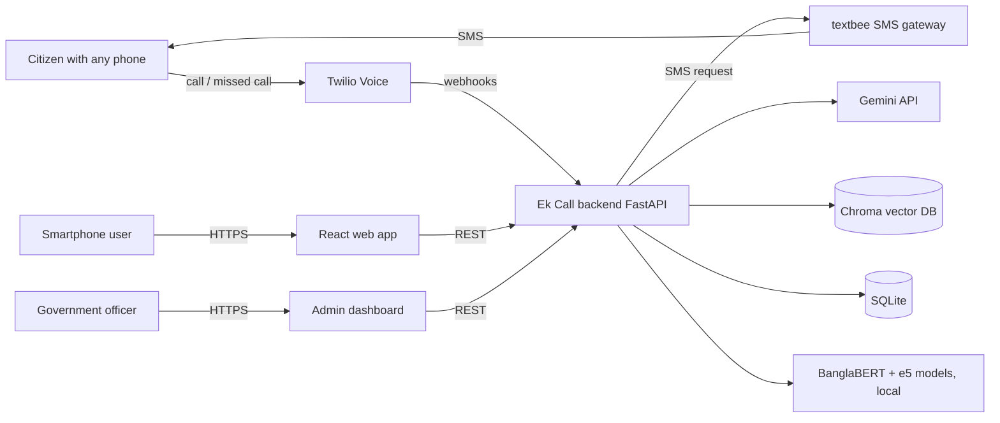
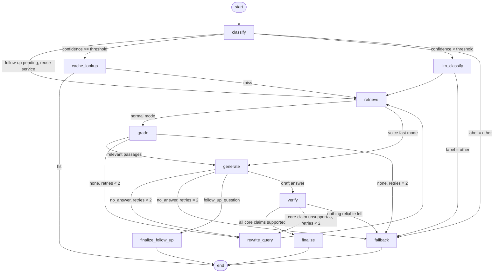

# Software Requirements Specification (SRS)

## Ek Call: A Bangla Voice AI Agent that Explains Government Services over a Simple Phone Call

| Item | Value |
|---|---|
| Team | MIST_Dreamers |
| Members | Md. Tamim Hossain, Md. Ariful Islam, Md. Ragib Hossain Rifat |
| Version | 1.3 (hackathon build, team split) |
| Date | 21 November 2026 |

---

## 1. Introduction

### 1.1 Purpose
This document says **what** Ek Call must do. It is the single source of truth for the team during the 2-day build.

### 1.2 Product scope
Ek Call lets any citizen of Bangladesh ask about a government service in spoken Bangla over a normal phone call, get a short answer taken only from official documents, and receive a checklist by SMS. The same AI agent is available in a web app (text or voice) and an admin dashboard shows what citizens ask most.

The first version covers **8 services**:

| ID | Service (English) | Service (Bangla) |
|---|---|---|
| `old_age_allowance` | Old Age Allowance | বয়স্ক ভাতা |
| `widow_allowance` | Widow Allowance | বিধবা ভাতা |
| `disability_allowance` | Disability Allowance | প্রতিবন্ধী ভাতা |
| `birth_registration` | Birth Registration | জন্ম নিবন্ধন |
| `nid_correction` | NID Correction | এনআইডি সংশোধন |
| `e_passport` | e-Passport | ই-পাসপোর্ট |
| `land_mutation` | Land Mutation (e-Namjari) | ই-নামজারি |
| `trade_licence` | Trade Licence | ট্রেড লাইসেন্স |
| `other` | Anything else (out of scope) | অন্যান্য |

### 1.3 Definitions

| Term | Meaning |
|---|---|
| Agent | The LangGraph workflow that turns a question into a checked answer |
| Router | The classifier that decides which service a question is about |
| RAG | Retrieval-Augmented Generation: answer using retrieved document passages |
| Passage | A chunk of an official document (about 300 words) stored in the vector DB |
| Claim | One small fact inside an answer (for example "men can apply from age 65") |
| Core claim | A claim the answer cannot stand without (who can apply, papers, fee, where to apply). The generate step marks it `core: true` |
| Pending follow-up | The previous assistant turn asked a follow-up question (status `follow_up`), so the next user turn is the answer to it |
| Verifier | The step that checks every claim against retrieved passages |
| Safe fallback | The fixed reply used when the agent cannot confirm an answer |
| Port | An interface (Python `Protocol`) defined in the application layer |
| Adapter | A concrete implementation of a port in the infrastructure layer |
| Turn | One question from the user plus one reply from Ek Call |
| TwiML | Twilio's XML language that tells a phone call what to do |

### 1.4 Priority keywords
- **MUST**: required for the demo. The build is not done without it.
- **SHOULD**: important; build it if the MUST items are done.
- **COULD**: nice to have; only if time is left.

Every requirement has an ID (for example `FR-AGT-04`) so tasks, commits and tests can refer to it.

### 1.5 Team responsibilities
Each member owns features end to end (backend and, where there is one, frontend). The step-by-step plan, owners and progress are in `docs/BUILD_PLAN.md`; first-time setup is in `docs/SETUP.md`.

| Member | Owns | Requirements |
|---|---|---|
| Md. Tamim Hossain (team lead) | AI agent and its data: official documents, question sets, router (TF-IDF, BanglaBERT, LLM), retrieval, LLM adapters, agent graph, verifier, answer cache, clustering APIs, evaluation. Keeps this SRS and the plan up to date. | FR-AGT, FR-DATA, FR-ADM-03, FR-ADM-04 (API) |
| Md. Ragib Hossain Rifat | Voice on the phone and in the app: Twilio call flow, call-back, missed call, signature check, async voice answer, text-to-speech; mic input, answer audio and "Call me" button in the app. | FR-CALL, FR-APP-03, 04, 06 |
| Md. Ariful Islam | Web app, SMS and admin: app pages, checklist card, sources, history; SMS adapters and background runner; admin APIs and dashboard (including the cluster view); demo data. | FR-SMS, FR-APP-01, 02, 05, 07 to 10, FR-ADM-01, 02, 04 (view), 05, 06 |

The API contract in Section 8 is shared by all three areas; a change to it is agreed by the team first and written into this document before the code changes.

---

## 2. Overall Description

### 2.1 Product perspective



### 2.2 Main functions
1. Answer phone calls in Bangla (incoming call, missed-call call-back, "Call me" button).
2. Understand the question (speech-to-text by Twilio, service routing by our BanglaBERT model).
3. Find the official rules (agentic RAG with grading and query rewriting).
4. Write a short spoken answer and a longer written answer with a checklist.
5. Check every fact against official passages (verifier) or refuse safely.
6. Send the checklist by SMS.
7. Offer the same agent in a web app with history, sources and voice input.
8. Show officers statistics, question clusters (K-Means) and unanswered questions.

### 2.3 User classes

| User | Device | Needs | Skill level |
|---|---|---|---|
| Rural / elderly citizen | Button phone | Short, clear spoken Bangla; SMS checklist | May not read well; no internet |
| Visually impaired citizen | Any phone | Voice only interaction | Any |
| Smartphone user / family member | Phone browser | Text or voice chat, history, sources | Basic app use |
| Government officer (admin) | Laptop browser | Stats, common problems, unanswered questions | Office computer use |
| Developer (team) | Laptop | Ingest docs, train and evaluate models | Technical |

### 2.4 Operating environment
- Backend: Python 3.11, FastAPI, runs on a normal laptop (Windows 10/11 or Linux), CPU only, 8 GB+ RAM.
- Public URL for Twilio webhooks: ngrok tunnel to the laptop.
- Frontend: React + Vite + TypeScript, served locally, tested in Chrome (desktop and Android).
- Model training: Google Colab or Kaggle free GPU.
- Phones: any GSM phone for calling; one Android phone with a Bangladeshi SIM running the textbee app for SMS.

### 2.5 Constraints
- **C-01 Time:** 2 days of build time with 3 people.
- **C-02 Cost:** free tiers only (Twilio trial, Gemini free tier, textbee, ngrok free).
- **C-03 Twilio trial:** can call and message only verified numbers (verify every demo phone in advance). Trial calls play a short trial notice first. Bangladesh must be enabled in Voice Geo Permissions for call-backs.
- **C-04 Twilio webhook timeout:** Twilio waits about 15 seconds for a webhook reply. A voice turn must reply well before that (see NFR-PERF-01).
- **C-05 Gemini free tier:** low requests-per-minute and per-day limits that change over time. Check the real limits in Google AI Studio. The design must keep LLM calls per question small (2 to 3) and support several API keys.
- **C-06 Hardware:** a normal laptop, no cloud GPU. The required local models are small (BanglaBERT about 110M parameters, multilingual-e5-small). A local LLM through Ollama (for example `qwen2.5:7b`) is **optional**: it is useful for development, for short jobs and as a quota fallback, but it is too slow and too weak in Bangla to be the only model for voice answers (a full answer is roughly 700 tokens, about 15 s on the development laptop).
- **C-07 Architecture:** Clean Architecture (Section 7) is mandatory.
- **C-08 Language:** all user-facing replies in Bangla. Code, comments and logs in English.

### 2.6 Assumptions and dependencies
- A-01: Official service information is public and is collected by the team before or during Day 1.
- A-02: Twilio speech recognition works acceptably for standard Bangla (`bn-BD`). If the language code is rejected, `bn-IN` is the fallback.
- A-03: The textbee Android phone stays online with balance during the demo.
- A-04: Internet is available at the venue (mobile hotspot as backup).
- A-05: Ollama with a model such as `qwen2.5:7b` is installed on the demo laptop. Without it the system still works with Gemini only (`LLM_BACKEND=gemini`).

---

## 3. External Interface Requirements

### 3.1 Phone (voice user interface)
Exact Bangla prompts are in Appendix A. The call flow:

1. Greeting with AI disclosure (Appendix A, `GREETING`).
2. Listen for speech (`<Gather input="speech" language="bn-BD">`).
3. Speak the answer (max about 45 words), then `CONTINUE` prompt and listen again.
4. If nothing is heard: `REPROMPT` once; on the second silence, `GOODBYE` and hang up.
5. If the caller says a goodbye phrase (for example "না", "আর কিছু না", "ধন্যবাদ"), reply `GOODBYE` and hang up. Exception: while a follow-up question is pending, a short "হ্যাঁ" or "না" is the answer to that question, not a goodbye.
6. Maximum 6 turns per call, then `GOODBYE`.

### 3.2 SMS
- Language: Bangla. Length: at most 300 characters (Bangla SMS is Unicode, about 67 characters per part).
- Format (example):

```
এক কল: বয়স্ক ভাতা
কারা: পুরুষ ৬৫+, নারী ৬২+, স্থায়ী বাসিন্দা
লাগবে: এনআইডি/জন্ম নিবন্ধন
ফি: বিনামূল্যে
কোথায়: অনলাইনে বা উপজেলা সমাজসেবা অফিস
সূত্র: সমাজসেবা অধিদফতর
```

### 3.3 Web app (citizen)
| Screen | Must show |
|---|---|
| Start | Phone number input (Bangladeshi format), short explanation, "Start" button |
| Chat | Message list, text box, big mic button, example question chips, "Call me" button |
| Answer bubble | Spoken-style answer, checklist card, list of sources (title + link), service tag |
| History | Past checklists for this phone number, newest first |

UI text is in Bangla with English sub-labels where useful. Large fonts and buttons (minimum 16 px text, 48 px tap targets). Colour theme: the Bangladesh flag (green `#006A4E`, red `#F42A41`); the flag red is used only for large text, icons and buttons, and a darker red for small text, so contrast stays readable.

### 3.4 Admin dashboard
| Panel | Content |
|---|---|
| KPI cards | Total questions, % answered, % fallback, average latency, calls today |
| By service | Bar chart of questions per service |
| By channel | Voice vs app counts |
| Clusters | K-Means groups: label, size, 3 example questions |
| Unanswered | Table of fallback questions (text, time, channel) |
| Recent activity | Last 20 questions with status and latency |

### 3.5 Software interfaces

| System | Use | Notes |
|---|---|---|
| Twilio Programmable Voice | Calls, Bangla speech-to-text (`<Gather>`), text-to-speech (`<Say>`) | Python `twilio` SDK; voices such as `Google.bn-IN-Standard-A` or `Google.bn-IN-Wavenet-A` |
| textbee | Send SMS from an Android phone | `POST https://api.textbee.dev/api/v1/gateway/send-sms`, header `x-api-key`, body `{"recipients": ["+8801..."], "message": "..."}` |
| Google Gemini API | Classification fallback, grading, answer writing, verification, dataset paraphrasing | `google-genai` SDK; model name from config; JSON output |
| Ollama (optional) | The same jobs as Gemini, on the local machine | HTTP `POST {OLLAMA_URL}/api/chat` with a JSON schema in `format`; no key, no quota |
| Hugging Face models | `csebuetnlp/banglabert` (fine-tuned router), `intfloat/multilingual-e5-small` (embeddings) | Loaded once at startup, CPU |
| ChromaDB | Vector store (persistent, local folder) | Embeddings computed by our own embedder |
| SQLite | Conversations, logs, checklists | SQLAlchemy 2.x |
| gTTS (COULD) | Bangla audio for the web app | Behind a `TTSPort`; browser speech synthesis as fallback |
| Web Speech API | Bangla speech input in the browser (`lang = "bn-BD"`) | Chrome only |

### 3.6 Communication interfaces
- REST over HTTP(S), JSON, UTF-8. Base path `/api/v1`.
- Twilio webhooks: `application/x-www-form-urlencoded` POST, reply `application/xml` (TwiML).
- CORS: only the frontend origin(s) from config.

---

## 4. Functional Requirements

### 4.1 Voice channel (`FR-CALL`)

| ID | Requirement | Priority | Acceptance check |
|---|---|---|---|
| FR-CALL-01 | When the Twilio number is called, the system answers with the Bangla greeting and listens for speech. | MUST | Call the number; hear greeting within 3 s. |
| FR-CALL-02 | Each recognised utterance (`SpeechResult`) is sent to the AskQuestion use case with `channel=voice` and the caller's number. | MUST | Log shows the Bangla text and service. |
| FR-CALL-03 | The spoken answer is at most about 45 words and is followed by the CONTINUE prompt inside the next `<Gather>` so the caller can interrupt. | MUST | Listen to answer length. |
| FR-CALL-04 | On empty speech, play REPROMPT once; on a second empty result, say GOODBYE and hang up. | MUST | Stay silent twice. |
| FR-CALL-05 | Goodbye intent ends the call politely. | SHOULD | Say "আর কিছু না". |
| FR-CALL-06 | Maximum 6 turns per call. | SHOULD | Unit test on TwiML builder. |
| FR-CALL-07 | `POST /api/v1/callback` places an outbound call to a given number; when answered, the same flow starts. (Used by the app "Call me" button and the demo.) At most one call-back per number per 60 s; a repeat returns HTTP 429 with `RATE_LIMITED`. | MUST | Click "Call me"; phone rings. Click again at once; get the Bangla wait message. |
| FR-CALL-08 | Missed-call mode: when `MISSED_CALL_MODE=true`, incoming calls are rejected (caller pays nothing) and the system calls back within 10 s. On a Twilio trial account the trial notice may play before our TwiML runs, so the call can be answered instead of rejected; check this early and use "Call me" for the demo if so. | SHOULD | Call, hear it rejected, receive call-back. |
| FR-CALL-09 | On any internal error during a call, speak ERROR and keep the call alive for one more try. | MUST | Kill the LLM key; call. |
| FR-CALL-10 | If an answer is not ready within the voice budget (4 s; on a real call Twilio already gave up on a 7.5 s reply), reply with WAIT_FILLER plus `<Redirect>` and deliver the answer on the next request (async answer pattern). | SHOULD | Add artificial delay; call still works. |
| FR-CALL-11 | Each call is stored (call SID, number, direction, start, end, turns). | SHOULD | Row in `calls` table. |
| FR-CALL-12 | Twilio request signatures are validated when `VALIDATE_TWILIO_SIGNATURE=true`, using the full URL Twilio called (`PUBLIC_URL` + path + query string) and the form parameters. | SHOULD | Forged POST returns 403; real calls still work. |

### 4.2 Agent (`FR-AGT`)

| ID | Requirement | Priority |
|---|---|---|
| FR-AGT-01 | Classify the question into one of the 9 labels (8 services + `other`) and return a confidence 0 to 1. | MUST |
| FR-AGT-02 | Router backend is selectable by config: `banglabert`, `tfidf`, or `llm`. | MUST |
| FR-AGT-03 | If router confidence < `ROUTER_CONFIDENCE_THRESHOLD` (default 0.7), ask the LLM to classify, giving it the router's top 3 labels as hints and the last 3 turns of the conversation. Record which router decided. | MUST |
| FR-AGT-04 | If the final label is `other`, go straight to the safe fallback (no RAG). | MUST |
| FR-AGT-05 | Retrieve the top 5 passages, filtered by the chosen service; if fewer than 2 passages pass the similarity threshold `RETRIEVAL_MIN_SCORE`, also search without the filter and merge the results. | MUST |
| FR-AGT-06 | Grade passages for relevance (one LLM call for all passages, JSON output). In voice fast mode, grading can be merged into generation. | SHOULD |
| FR-AGT-07 | If no relevant passage is found (by `grade`, or by `generate` returning `no_answer` when grading is skipped), rewrite the query (LLM) and retrieve again, at most 2 times in total (one retry counter shared with FR-AGT-10), then fall back. | MUST |
| FR-AGT-08 | Generate one JSON object containing: `no_answer` (true when the passages do not answer the question), `speech_text` (Bangla, at most 45 words), `display_text` (Bangla, markdown), `checklist` (`who`, `papers`, `fee`, `where`, `decision`), `claims` (each with `text`, supporting `passage_ids` and `core` true/false), and optional `follow_up_question`. | MUST |
| FR-AGT-09 | The agent may ask **one** short follow-up question when a key eligibility fact is missing (for example permanent residence, age). The previous turns of the conversation are included in the prompt. | SHOULD |
| FR-AGT-10 | Verify every claim against the cited passages (one LLM call). Unsupported claims are removed; if a core claim is unsupported and retries remain, rewrite and retrieve again; if nothing reliable is left, fall back. | MUST |
| FR-AGT-11 | The answer never states that the user will receive a benefit; it explains rules and says who decides. | MUST |
| FR-AGT-12 | Every answered response includes citations (document title + source URL + short snippet). | MUST |
| FR-AGT-13 | Safe fallback uses the exact FALLBACK text (Appendix A) and suggests 333 or the right office. | MUST |
| FR-AGT-14 | The agent records timings per step and the number of LLM calls. | SHOULD |
| FR-AGT-15 | Repeated questions within 24 h are served from a cache. Key = normalised text (trimmed, lower case, punctuation removed, Bangla digits turned into 0-9) + service + channel. The lookup happens right after `classify`, only when the local router was confident and the label is not `other`, so context-dependent replies such as "হ্যাঁ" are never served from the cache. Only `answered` results are stored. | SHOULD |
| FR-AGT-16 | Gemini adapter rotates across several API keys on HTTP 429 and retries once with back-off. | MUST |
| FR-AGT-17 | If a follow-up is pending, skip classification and keep the service of the previous assistant turn (`router_source = context`), so a short reply such as "হ্যাঁ" is not routed to `other`. | SHOULD |
| FR-AGT-18 | The LLM backend is selectable by config: `gemini`, `ollama` or `hybrid`. In `hybrid`, FAST-role jobs (grading, rewriting, classification) go to Ollama and MAIN-role jobs (generation, verification) go to Gemini; if Gemini is unavailable (quota, outage) the MAIN job falls back to Ollama. Every answer log records which backend produced it. | SHOULD |
| FR-AGT-19 | Situation understanding: when the router is unsure, says `other`, sees a likely 2nd service (`MULTI_SERVICE_MIN_PROB`), or the situation hint router (TF-IDF trained with situations) disagrees or is unsure, the `understand` step extracts up to 2 services, the caller's facts, a summary and one search query per service. Off-topic questions are still refused. | MUST |
| FR-AGT-20 | Query expansion: retrieval searches with the caller's words, the service's `search_terms_bn` and the `understand` query, merged per service. | MUST |
| FR-AGT-21 | Multi-service questions (max 2): retrieval, checklists and SMS per service. | MUST |
| FR-AGT-22 | Service-attributed grounding: every claim names its service and cites a passage of that same service (checked in code by `grounding_guard`); contradicting rules are shown side by side with both sources; two sides stating the same rule are not a conflict; no rule is declared the winner unless a document says so; `CONFLICT_NOTE` / `COMBINE_UNKNOWN` are fixed texts. | MUST |
| FR-AGT-23 | One follow-up question may be used to tell two candidate services apart, or when a question is too vague to pick any service. | SHOULD |

### 4.3 SMS (`FR-SMS`)

| ID | Requirement | Priority |
|---|---|---|
| FR-SMS-01 | After the first answered turn about a service in a call, send one SMS checklist for that service to the caller. | MUST |
| FR-SMS-02 | Never send more than one SMS per service per call. | MUST |
| FR-SMS-03 | SMS backend selectable by config: `textbee` or `console` (prints instead of sending). | MUST |
| FR-SMS-04 | SMS sending happens in the background and never delays the spoken answer. | MUST |
| FR-SMS-05 | Failed sends are logged; the call continues normally. | MUST |
| FR-SMS-06 | App users can press "Send to my phone" on a checklist card. | COULD |

### 4.4 Web app (`FR-APP`)

| ID | Requirement | Priority |
|---|---|---|
| FR-APP-01 | User enters a Bangladeshi phone number (`01XXXXXXXXX` or `+8801XXXXXXXXX`); it is normalised to E.164 and kept in local storage. | MUST |
| FR-APP-02 | User can type a question and see the answer, checklist card and sources. | MUST |
| FR-APP-03 | User can hold or tap the mic button to speak in Bangla (Web Speech API, `bn-BD`); the recognised text is sent as the question. | MUST |
| FR-APP-04 | User can play the answer as audio (`/api/v1/tts` or browser speech synthesis). | SHOULD |
| FR-APP-05 | History page lists past checklists for the phone number (shared with phone calls). | MUST |
| FR-APP-06 | "Call me" button triggers `POST /api/v1/callback`. | MUST |
| FR-APP-07 | Example question chips for the main services. | SHOULD |
| FR-APP-08 | Loading state while the agent works; friendly Bangla error message on failure. | MUST |
| FR-APP-09 | One-time code by SMS before showing history of a number (family use case UC5). | COULD |
| FR-APP-10 | Installable as a PWA. | COULD |
| FR-APP-11 | App shows the situation summary, one checklist card per service and a "rules differ" box with both sources. | MUST |

### 4.5 Admin (`FR-ADM`)

| ID | Requirement | Priority |
|---|---|---|
| FR-ADM-01 | `GET /api/v1/admin/stats` returns KPI numbers, per-service and per-channel counts. | MUST |
| FR-ADM-02 | `GET /api/v1/admin/questions?status=fallback` lists unanswered questions. | MUST |
| FR-ADM-03 | `POST /api/v1/admin/clusters/rebuild` runs K-Means on question embeddings (k chosen by silhouette score in range 3 to 8, or fixed k when there are few questions) and stores cluster IDs. | SHOULD |
| FR-ADM-04 | `GET /api/v1/admin/clusters` returns each cluster with a short label (top keywords or an LLM-written label), size and 3 examples. | SHOULD |
| FR-ADM-05 | Admin endpoints require the `X-Admin-Token` header when `ADMIN_TOKEN` is set. | SHOULD |
| FR-ADM-06 | Dashboard auto-refreshes every 10 s during the demo. | COULD |

### 4.6 Data and ML pipeline (`FR-DATA`)

| ID | Requirement | Priority |
|---|---|---|
| FR-DATA-01 | `data/services.yaml` defines the 9 labels with Bangla and English names, office and SMS short name. | MUST |
| FR-DATA-02 | Each official document is stored as `data/raw_docs/<service_id>/<slug>.md` with YAML front matter: `title`, `source_url`, `office`, `collected_on`. | MUST |
| FR-DATA-03 | `python -m scripts.ingest` chunks documents (about 160 words, 40-word overlap, split on headings first; Bangla averages about 2.2 e5 tokens per word, so this stays under e5's 512-token input), embeds them with the `passage: ` prefix and stores them in Chroma with metadata (`service_id`, `title`, `source_url`, `chunk_id`). Re-running replaces the collection. | MUST |
| FR-DATA-04 | `data/questions/seed.csv` holds hand-written questions (`text,label`); `data/questions/test.csv` holds a separate hand-written test set (about 12 per label) that is never augmented. | MUST |
| FR-DATA-05 | `python -m scripts.augment_questions` paraphrases the seeds with the LLM (casual speech, spelling mistakes, mixed Bangla-English, speech-recognition-style errors) into `train.csv` and `val.csv`. Splitting happens before augmentation. | MUST |
| FR-DATA-06 | `python -m scripts.train_baseline` trains TF-IDF (character n-grams 2 to 5) + logistic regression and saves it to `data/models/tfidf_router.joblib`. | MUST |
| FR-DATA-07 | `ml/train_router.py` (run on Colab) fine-tunes `csebuetnlp/banglabert` for 9-way classification (3 to 5 epochs, max length 64) with the BanglaBERT text normaliser, and saves model, tokenizer and `labels.json`. | MUST |
| FR-DATA-08 | `python -m scripts.eval_router` prints accuracy, macro-F1 and a confusion matrix for TF-IDF and BanglaBERT on `test.csv` and writes `docs/results/router_eval.md`. | MUST |
| FR-DATA-09 | `python -m scripts.eval_rag` computes Recall@5 (is a passage of the gold service in the top 5) and safe-refusal rate on out-of-scope questions, and writes `docs/results/rag_eval.md`. | SHOULD |
| FR-DATA-10 | `situation_seed.csv` (training), `situation_test.csv` and `mixed_test.csv` (hand-written, never augmented); the augment script's leak check keeps every evaluation set out of the training data. | MUST |
| FR-DATA-11 | `scripts/eval_situation.py` writes before/after results to `docs/results/situation_eval.md`. | MUST |

---

## 5. Non-Functional Requirements

| ID | Category | Requirement |
|---|---|---|
| NFR-PERF-01 | Performance | Voice turn (end of speech to start of reply): median at most 5 s; 95th percentile at most 10 s; never more than 13 s (use FR-CALL-10 if needed). |
| NFR-PERF-02 | Performance | App answer: median at most 6 s. |
| NFR-PERF-03 | Performance | Router inference at most 200 ms and retrieval at most 300 ms on a laptop CPU. |
| NFR-PERF-04 | Performance | Models and the vector store are loaded once at startup, not per request. |
| NFR-REL-01 | Reliability | Any adapter failure (LLM, SMS, vector DB) produces a polite Bangla message, never a stack trace or a dead call. |
| NFR-REL-02 | Reliability | `GET /health` reports the status of the LLM, vector DB, router and DB. |
| NFR-SEC-01 | Security | Secrets only in `.env` (never committed); `.env.example` documents every variable. |
| NFR-SEC-02 | Security | Admin token, Twilio signature validation, CORS allow-list (see FR-ADM-05, FR-CALL-12). |
| NFR-PRIV-01 | Privacy | No NID numbers, documents or photos are stored. `question_logs` stores a salted SHA-256 hash of the phone number, not the number. |
| NFR-PRIV-02 | Privacy | Every call begins with the AI disclosure. |
| NFR-PRIV-03 | Privacy | `DELETE /api/v1/conversations/{phone}` removes a user's history (SHOULD). |
| NFR-USE-01 | Usability | Plain everyday Bangla, short sentences, no English jargon in spoken answers. Numbers spoken in Bangla. |
| NFR-USE-02 | Usability | Web UI usable on a 360 px wide phone screen. |
| NFR-MNT-01 | Maintainability | Clean Architecture dependency rule is enforced by an automated test (`tests/test_architecture.py`). |
| NFR-MNT-02 | Maintainability | Type hints everywhere; `ruff` passes; `pytest` passes. |
| NFR-MNT-03 | Maintainability | Every external service sits behind a port, so it can be swapped by config (for example `SMS_BACKEND=console`). |
| NFR-TEST-01 | Testability | Use cases and agent steps are unit-tested with fake adapters (no network). |
| NFR-PORT-01 | Portability | Runs on Windows and Linux; commands documented for both. |

---

## 6. Data Requirements

### 6.1 Domain entities
| Entity | Key fields |
|---|---|
| `Service` | `id`, `name_bn`, `name_en`, `office_bn`, `sms_name` |
| `PhoneNumber` (value object) | E.164 string; validates Bangladeshi mobile format `+8801[3-9]XXXXXXXX` |
| `Channel` (enum) | `voice`, `app`, `sms` |
| `AnswerStatus` (enum) | `answered`, `follow_up`, `fallback`, `error` |
| `RouterSource` (enum) | `banglabert`, `tfidf`, `llm`, `context`, `situation` |
| `Citation` | `title`, `source_url`, `snippet`, `chunk_id` |
| `Checklist` | `service_id`, `who`, `papers` (list), `fee`, `where`, `decision` |
| `Answer` | `status`, `service_id`, `confidence`, `router_source`, `speech_text`, `display_text`, `checklist`, `citations`, `follow_up_question`, `timings`, `llm_calls` |
| `Message` | `role`, `channel`, `text`, `service_id`, `status`, `created_at` |
| `QuestionLog` | `phone_hash`, `channel`, `text`, `service_id`, `confidence`, `router_source`, `status`, `latency_ms`, `llm_calls`, `llm_backend`, `cluster_id`, `is_demo`, `created_at` |

### 6.2 Database tables (SQLite)

| Table | Columns |
|---|---|
| `conversations` | `id` (uuid, PK), `phone` (E.164, indexed), `created_at`, `updated_at` |
| `messages` | `id` (PK), `conversation_id` (FK), `role` (`user`/`assistant`), `channel`, `text`, `service_id`, `status`, `call_sid` (nullable), `created_at` |
| `checklists` | `id` (PK), `phone` (indexed), `service_id`, `content_json`, `citations_json`, `sms_sent` (bool), `call_sid` (nullable), `created_at` |
| `question_logs` | `id` (PK), `phone_hash`, `channel`, `text`, `service_id`, `confidence`, `router_source`, `status`, `latency_ms`, `llm_calls`, `llm_backend` (nullable, FR-AGT-18), `cluster_id` (nullable), `is_demo` (bool, default false), `created_at` |
| `calls` | `id` (PK), `call_sid` (unique), `phone`, `direction`, `started_at`, `ended_at`, `turns` |
| `clusters` | `id` (PK), `label`, `size`, `examples_json`, `created_at` |
| `answer_cache` | `key` (PK: normalised text + service + channel), `answer_json`, `created_at` (24 h TTL, FR-AGT-15) |
| `otp_codes` (COULD) | `phone`, `code_hash`, `expires_at` |

### 6.3 Files
| Path | Format |
|---|---|
| `data/services.yaml` | List of services (Section 1.2 table) |
| `data/raw_docs/<service_id>/*.md` | Markdown with YAML front matter |
| `data/questions/seed.csv`, `train.csv`, `val.csv`, `test.csv` | `text,label` (UTF-8) |
| `data/chroma/` | Chroma persistent store (git-ignored) |
| `data/models/router/` | Fine-tuned BanglaBERT (git-ignored, shared by Drive) |
| `data/models/tfidf_router.joblib` | Baseline model |

---

## 7. Architecture Requirements (Clean Architecture)

### 7.1 Layers and the dependency rule
```
interfaces (FastAPI routers, Twilio webhooks)  ─┐
infrastructure (Gemini, Chroma, Twilio, textbee, ─┼──> application (use cases, ports, agent steps) ──> domain (entities, policies)
                SQLAlchemy, BanglaBERT, LangGraph)─┘
```
- **AR-01** `domain` imports only the Python standard library.
- **AR-02** `application` imports only `domain` and the standard library. It defines all ports as `typing.Protocol`.
- **AR-03** `infrastructure` implements ports and may import any library. LangGraph lives here: it only wires the framework-free agent step functions from `application`.
- **AR-04** `interfaces` only converts HTTP/TwiML to and from use-case DTOs. No business logic.
- **AR-05** `app/container.py` is the only place that creates adapters and injects them (composition root), driven by `config.py` settings.
- **AR-06** `tests/test_architecture.py` fails if any file breaks AR-01 to AR-04.

### 7.2 Ports (application/ports)

| Port | Methods (simplified) | Adapters |
|---|---|---|
| `ServiceClassifier` | `classify(text) -> list[(label, score)]` | `BanglaBertClassifier`, `TfidfClassifier`, `LlmClassifier` |
| `Embedder` | `embed_query(text)`, `embed_passages(texts)` | `E5Embedder` |
| `Retriever` | `search(query, service_id_or_none, k) -> list[Passage]` | `ChromaRetriever` |
| `LLM` | `generate_json(prompt, schema, role) -> dict` (`role` = `main` or `fast`), `generate_text(prompt)`, `check() -> bool` (cheap availability check for `/health`) | `GeminiLLM`, `OllamaLLM`, `RoutedLLM` (picks between them for `hybrid`), `FakeLLM` (tests) |
| `AnswerEngine` | `answer(question, history, channel) -> Answer` | `LangGraphAnswerEngine` |
| `SmsSender` | `send(phone, text) -> bool` | `TextbeeSms`, `ConsoleSms` |
| `CallPlacer` | `call(phone) -> call_sid` | `TwilioCallPlacer` |
| `TextToSpeech` | `synthesize(text) -> bytes` | `GttsTts` |
| `ConversationRepo`, `ChecklistRepo`, `QuestionLogRepo`, `CallRepo`, `ClusterRepo` | CRUD needed by use cases | SQLAlchemy repositories |
| `AnswerCache` | `get(key)`, `set(key, answer)` | `SqliteAnswerCache` or in-memory |
| `Clusterer` | `cluster(vectors) -> labels` | `KMeansClusterer` |
| `BackgroundRunner` | `submit(fn, *args, delay_s=0)` | `ThreadPoolRunner` (an inline runner in tests) |

- Tunable values (thresholds, retries, TTLs) come from `config.py` and are passed in by the container; `domain/policies.py` holds only the defaults.
- Background or delayed work (SMS, call-back, async voice answer) goes through `BackgroundRunner`. Application code never uses FastAPI `BackgroundTasks` or `asyncio` tasks directly.

### 7.3 Use cases (application/use_cases)
`AskQuestion`, `StartCallback`, `HandleCallEnd`, `GetHistory`, `DeleteHistory`, `GetAdminStats`, `ListQuestions`, `RebuildClusters`, `GetClusters`, `SynthesizeSpeech`.

### 7.4 Agent graph



- `retries` is one counter shared by the grade, generate and verify loops (maximum `MAX_RETRIEVAL_RETRIES` = 2).
- Voice fast mode = `VOICE_FAST_MODE=true` and `channel = voice`: `grade` is skipped and `generate` decides `no_answer` itself.
- `finalize` drops unsupported non-core claims and stores `answered` results in the cache (FR-AGT-15).

`AgentState` fields: `question`, `history`, `channel`, `pending_service_id`, `candidates`, `service_id`, `confidence`, `router_source`, `query`, `passages`, `relevant_ids`, `retries`, `draft`, `verified_claims`, `answer`, `timings`, `llm_calls`.

---

## 8. API Specification

All JSON. Base `/api/v1` unless noted. FastAPI also serves Swagger at `/docs`.

| Method | Path | Body / query | Response | Req. |
|---|---|---|---|---|
| GET | `/health` | none | `{"status":"ok","llm":"ok","vector_db":"ok","router":"banglabert","db":"ok"}` | NFR-REL-02 |
| GET | `/api/v1/services` | none | list of services | FR-DATA-01 |
| POST | `/api/v1/chat` | `{"phone","message","channel":"app"}` (`channel` optional; only `app` is accepted, voice turns come through `/voice/*`) | `ChatResponse` (below) | FR-APP-02 |
| GET | `/api/v1/conversations/{phone}` | `?limit=50` | messages + checklists | FR-APP-05 |
| DELETE | `/api/v1/conversations/{phone}` | none | `{"deleted": true}` | NFR-PRIV-03 |
| POST | `/api/v1/callback` | `{"phone"}` | `{"call_sid"}`; 429 if the same number was called in the last 60 s | FR-CALL-07 |
| POST | `/api/v1/tts` | `{"text"}` | `audio/mpeg` | FR-APP-04 |
| GET | `/api/v1/admin/stats` | none | KPIs | FR-ADM-01 |
| GET | `/api/v1/admin/questions` | `?status=&limit=` | question logs | FR-ADM-02 |
| POST | `/api/v1/admin/clusters/rebuild` | none | `{"clusters": n}` | FR-ADM-03 |
| GET | `/api/v1/admin/clusters` | none | clusters | FR-ADM-04 |
| POST | `/voice/incoming` | Twilio form | TwiML | FR-CALL-01, 08 |
| POST | `/voice/start` | Twilio form | TwiML | FR-CALL-07 |
| POST | `/voice/respond` | Twilio form (`SpeechResult`, `CallSid`, `From`, `To`, `Direction`) | TwiML | FR-CALL-02 to 06 |
| POST | `/voice/result` | `?job=<id>` | TwiML | FR-CALL-10 |
| POST | `/voice/status` | Twilio status callback | `204` | FR-CALL-11 |

`ChatResponse` example:

```json
{
  "conversation_id": "7f6c...",
  "status": "answered",
  "service": {"id": "old_age_allowance", "name_bn": "বয়স্ক ভাতা", "name_en": "Old Age Allowance"},
  "confidence": 0.93,
  "router": "banglabert",
  "speech_text": "পুরুষদের ৬৫ বছর হলে আবেদন করা যায়, আর আবেদন সম্পূর্ণ বিনামূল্যে। জাতীয় পরিচয়পত্র লাগবে।",
  "display_text": "**বয়স্ক ভাতা**\n- পুরুষ ৬৫+, নারী ৬২+ ...",
  "checklist": {
    "who": "পুরুষ ৬৫+, নারী ৬২+, স্থায়ী বাসিন্দা",
    "papers": ["জাতীয় পরিচয়পত্র বা জন্ম নিবন্ধন"],
    "fee": "বিনামূল্যে",
    "where": "অনলাইনে বা উপজেলা সমাজসেবা অফিসে",
    "decision": "স্থানীয় বাছাই কমিটি"
  },
  "citations": [{"title": "বয়স্ক ভাতা কার্যক্রম", "source_url": "https://...", "snippet": "...", "chunk_id": "old_age_allowance-002"}],
  "follow_up_question": null,
  "latency_ms": 3210,
  "mode": "single",
  "situation": null,
  "services": [{"id": "old_age_allowance", "name_bn": "বয়স্ক ভাতা", "name_en": "Old Age Allowance"}],
  "checklists": [{"service_id": "old_age_allowance", "who": "...", "papers": ["..."], "fee": "...", "where": "...", "decision": "..."}],
  "conflicts": []
}
```

`mode`, `situation`, `services`, `checklists` and `conflicts` are additive (FR-AGT-19 to 22, FR-APP-11). For a two-service answer `mode` is `multi`, `services` and `checklists` have one entry per service (the old `service` and `checklist` stay the primary service), `situation` is `{"summary_bn": "...", "facts": {"age": "৬৬"}}`, and each conflict is `{"topic_bn": "...", "sides": [{"service_id", "rule_bn", "source_title", "source_url"}, ...]}`.

Error format for all endpoints: `{"error": {"code": "LLM_UNAVAILABLE", "message_bn": "...", "message_en": "..."}}`.

`/health` fields are `ok`, `error` or `not_configured` (`router` shows the active backend). The LLM check uses `LLM.check()` (list models with the key, no generation), cached for 60 s, so it does not use answer quota.

---

## 9. Configuration (`.env`)

| Variable | Example | Purpose |
|---|---|---|
| `APP_ENV` | `dev` | dev / demo |
| `PUBLIC_URL` | `https://xxxx.ngrok-free.app` | Base URL Twilio calls back to |
| `FRONTEND_ORIGINS` | `http://localhost:5173` | CORS allow-list (comma separated) |
| `DATABASE_URL` | `sqlite:///./data/ekcall.db` | SQLAlchemy URL |
| `GEMINI_API_KEYS` | `key1,key2,key3` | Rotated on 429 |
| `GEMINI_MODEL_MAIN` | (check AI Studio for a free Flash model) | Generation and verification |
| `GEMINI_MODEL_FAST` | (a free Flash-Lite model) | Grading, rewriting, classification |
| `LLM_BACKEND` | `gemini` / `ollama` / `hybrid` | FR-AGT-18 (`GEMINI_*` values are needed for `gemini` and `hybrid`) |
| `OLLAMA_URL` | `http://localhost:11434` | Ollama server |
| `OLLAMA_MODEL` | `qwen2.5:7b` | Model name as shown by `ollama list` |
| `ROUTER_BACKEND` | `tfidf` / `banglabert` / `llm` | FR-AGT-02 |
| `ROUTER_MODEL_DIR` | `data/models/router` | BanglaBERT folder |
| `ROUTER_CONFIDENCE_THRESHOLD` | `0.7` | FR-AGT-03 |
| `SITUATION_MODE` | `true` | FR-AGT-19 to 23 (`false` restores the single-service flow) |
| `MULTI_SERVICE_MIN_PROB` | `0.25` | FR-AGT-19 |
| `MAX_SERVICES_PER_QUESTION` | `2` | FR-AGT-21 |
| `QUERY_EXPANSION` | `true` | FR-AGT-20 |
| `MAX_SPEECH_WORDS_MULTI` | `60` | FR-AGT-21 spoken answer limit |
| `SITUATION_HINT_MODEL_PATH` | `data/models/tfidf_router_v2.joblib` | FR-AGT-19 (missing file = no hint router) |
| `SITUATION_HINT_MIN_CONFIDENCE` | `0.35` | FR-AGT-19: the hint router below this sends the question to `understand` |
| `EMBED_MODEL` | `intfloat/multilingual-e5-small` | Embeddings |
| `CHROMA_DIR` | `data/chroma` | Vector store |
| `RETRIEVAL_MIN_SCORE` | `0.80` | FR-AGT-05 similarity threshold (tune on real questions; e5 scores sit close together) |
| `VOICE_FAST_MODE` | `true` | Merge grading into generation for calls |
| `AGENT_ENGINE` | `langgraph` / `stub` | `stub` returns a fixed sample answer (development without keys) |
| `TWILIO_ACCOUNT_SID`, `TWILIO_AUTH_TOKEN`, `TWILIO_NUMBER` | | Telephony |
| `STT_LANGUAGE` | `bn-BD` | `<Gather language>` (fallback `bn-IN`) |
| `TTS_VOICE`, `TTS_LANGUAGE` | `Google.bn-IN-Standard-A`, `bn-IN` | `<Say>` |
| `MISSED_CALL_MODE` | `false` | FR-CALL-08 |
| `VALIDATE_TWILIO_SIGNATURE` | `false` (dev) / `true` (demo) | FR-CALL-12 |
| `SMS_BACKEND` | `console` / `textbee` | FR-SMS-03 |
| `TEXTBEE_API_KEY`, `TEXTBEE_DEVICE_ID` | | SMS |
| `ADMIN_TOKEN` | random string | FR-ADM-05 |
| `PHONE_HASH_SALT` | random string | NFR-PRIV-01 |

---

## 10. Acceptance Scenarios (demo script)

| # | Use case | Steps | Expected result |
|---|---|---|---|
| S1 | UC1 Elderly caller | Call (or "Call me"), ask "আমার বয়স ৬৭। আমি কি বয়স্ক ভাতা পাবো? কী কী লাগবে?" | Router: `old_age_allowance`. Short Bangla answer with age rules and NID needed (the fee is "তথ্য পাওয়া যায়নি": no official document states one); SMS arrives with checklist. |
| S2 | UC2 Follow-up | Ask "বিধবা ভাতার জন্য কী লাগে?" | Agent may ask about permanent residence, then answers after "হ্যাঁ" (same service kept, FR-AGT-17; "হ্যাঁ" does not end the call). |
| S3 | UC3 SMS | After S1 | Exactly one SMS for that service, at most 300 characters. |
| S4 | UC4 App | Type "NID-te namer banan bhul, ki korbo?" | `nid_correction`; checklist card + at least 1 source link. |
| S5 | UC5 Family | Open History with the S1 phone number | The S1 checklist is listed. |
| S6 | UC6 Officer | Open dashboard, rebuild clusters | Stats show S1 to S5; clusters and unanswered list visible. |
| S7 | Exception | Ask "প্রতিবেশীর সাথে জমি নিয়ে ঝামেলা, কী করবো?" | Label `other` or no support; exact FALLBACK text; logged as fallback. |
| S8 | Robustness | Stay silent twice on a call | REPROMPT, then GOODBYE and hang up. |
| S9 | Failure | Set a wrong Gemini key and ask | Bangla ERROR message, no crash; `/health` shows `llm: error`. |

---

## 11. Evaluation Targets

| Metric | How | Target |
|---|---|---|
| Router accuracy / macro-F1 | `eval_router` on hand-written `test.csv`, BanglaBERT vs TF-IDF | at least 90% accuracy |
| Retrieval Recall@5 | `eval_rag` | at least 90% |
| Answer correctness | Team checks 30 to 40 answers against documents (limited by free LLM quota) | at least 90% |
| Safe refusal | 20 to 30 out-of-scope questions | at least 95% |
| Voice latency | Logged `latency_ms` for voice | median at most 5 s |

Every result table must state which `LLM_BACKEND` and model produced it, because answer quality and latency differ between Gemini and a local model.

---

## 12. Out of Scope (this build)
- Deciding eligibility or submitting applications.
- Full regional dialect support (only tested and reported).
- A real Bangladeshi or toll-free number.
- User accounts beyond phone number (OTP is COULD).
- Production deployment, scaling, monitoring.

---

## 13. Traceability

| Use case | Requirements |
|---|---|
| UC1 Ask by phone | FR-CALL-01 to 04, 07, FR-AGT-01 to 13, FR-AGT-18 |
| UC2 Follow-up | FR-AGT-09, FR-AGT-17, FR-CALL-03 |
| UC3 SMS checklist | FR-SMS-01 to 05 |
| UC4 Ask in app | FR-APP-01 to 04, 08 |
| UC5 Shared history | FR-APP-05, FR-APP-09 |
| UC6 Dashboard | FR-ADM-01 to 06 |
| Exception (unknown) | FR-AGT-04, 07, 10, 13 |

---

## Appendix A: Fixed Bangla strings (`app/domain/messages_bn.py`)

| Key | Text |
|---|---|
| `GREETING` | আসসালামু আলাইকুম। আমি এক কল, একটি এআই সহকারী। সরকারি সেবা নিয়ে কী জানতে চান, বলুন। |
| `CONTINUE` | আর কিছু জানতে চাইলে বলুন। |
| `REPROMPT` | দুঃখিত, আমি শুনতে পাইনি। আবার বলবেন? |
| `WAIT_FILLER` | একটু অপেক্ষা করুন, আমি দেখে বলছি। |
| `FALLBACK` | দুঃখিত, এই বিষয়ে সরকারি কাগজে আমি নিশ্চিত তথ্য পাইনি। দয়া করে ৩৩৩ নম্বরে ফোন করুন অথবা উপজেলা অফিসে যোগাযোগ করুন। |
| `ERROR` | দুঃখিত, এখন একটু সমস্যা হচ্ছে। একটু পরে আবার চেষ্টা করুন অথবা ৩৩৩ নম্বরে ফোন করুন। |
| `SMS_SENT` | আপনার মোবাইলে এসএমএস পাঠানো হয়েছে। |
| `GOODBYE` | ধন্যবাদ। ভালো থাকবেন। |
| `DECISION_NOTE` | চূড়ান্ত সিদ্ধান্ত সংশ্লিষ্ট অফিস নেবে। |
| `RATE_LIMITED` | একটু আগেই আপনাকে কল করা হয়েছে। এক মিনিট পরে আবার চেষ্টা করুন। |
| `INVALID_PHONE` | মোবাইল নম্বরটি সঠিক নয়। ০১ দিয়ে শুরু ১১ অঙ্কের নম্বর দিন। |
| `NOT_FOUND` | কোনো তথ্য পাওয়া যায়নি। |
| `BAD_REQUEST` | অনুরোধটি সঠিক নয়। তথ্যগুলো দেখে আবার চেষ্টা করুন। |
| `MULTI_INTRO` | আপনার কথায় দুটি সেবার কথা আসছে: {a} আর {b}। |
| `CONFLICT_NOTE` | এই দুই সেবার নিয়ম আলাদা। আপনার ক্ষেত্রে কোনটি প্রযোজ্য, তা উপজেলা অফিস ঠিক করবে। |
| `COMBINE_UNKNOWN` | দুটি সুবিধা একসাথে পাওয়া যায় কিনা, সরকারি কাগজে আমি নিশ্চিত তথ্য পাইনি। |
| `TWO_SMS` | দুটি সেবার জন্য আলাদা দুটি এসএমএস পাঠানো হয়েছে। |
| `SITUATION_HEARD` | আমি যা বুঝেছি: {summary} |

## Appendix B: Prompt rules (for the agent steps)
1. Answer **only** from the given passages. If the passages do not contain the answer, return `"no_answer": true`.
2. Write for a rural elderly listener: everyday Bangla, short sentences, no English words in `speech_text` unless there is no Bangla word (for example "এনআইডি").
3. `speech_text` at most 45 words; mention that details are coming by SMS when channel is voice.
4. Never promise a benefit. Always say who decides (`DECISION_NOTE`).
5. Every claim lists the passage IDs that support it and says whether it is core.
6. Ask at most one follow-up question, and only when an eligibility fact is missing and needed.
7. Output must match the JSON schema exactly; no extra text.
8. Use the last 3 turns of the conversation to understand short replies (for example "হ্যাঁ") and questions such as "আর কী লাগে?".
